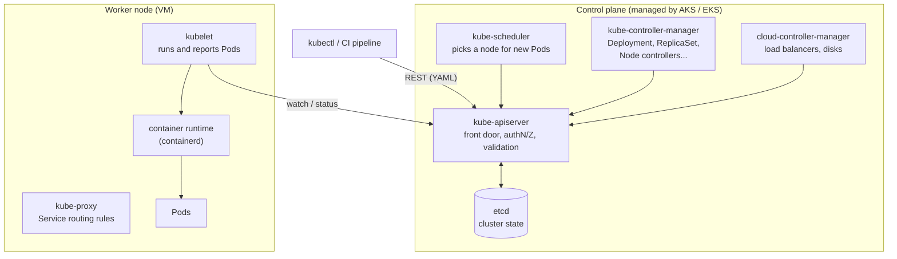
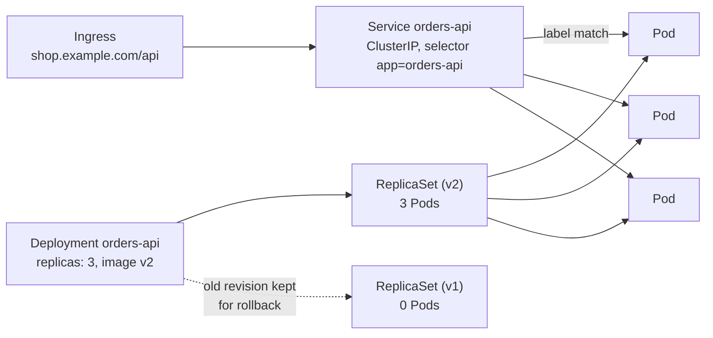

import { Tabs, TabItem, Aside } from '@astrojs/starlight/components';
import QuizBlock from '~/components/QuizBlock.astro';

## Why it matters in interviews

Kubernetes questions follow a predictable path: *"explain the architecture"*, *"Pod vs Deployment?"*, *"how does traffic reach a Pod?"*, *"ClusterIP vs NodePort vs LoadBalancer?"*, *"ConfigMap vs Secret, and is a Secret encrypted?"*. You are not expected to run a cluster by hand at 3-4 years, but you must explain how your containers get scheduled, discovered and exposed, and be able to read a manifest.

## Core idea

Kubernetes (K8s) is a **container orchestrator**. You declare the **desired state** ("3 replicas of `orders-api:1.4.2`, reachable at `shop.example.com/api`") as YAML objects, and **controllers** continuously compare actual state with desired state and act to close the gap (the **reconciliation loop**). If a node dies, its Pods are recreated elsewhere; if you change the image tag, a rolling update starts.

### Architecture



| Component | Where | Job |
|---|---|---|
| **kube-apiserver** | Control plane | The only component that talks to etcd; every client (kubectl, kubelet, controllers) goes through it |
| **etcd** | Control plane | Consistent key-value store holding all cluster state |
| **kube-scheduler** | Control plane | Assigns unscheduled Pods to nodes based on resource requests, affinity, taints |
| **kube-controller-manager** | Control plane | Runs controllers (Deployment, ReplicaSet, Job, Node...) that reconcile state |
| **cloud-controller-manager** | Control plane | Talks to Azure / AWS: creates load balancers for Services, attaches disks |
| **kubelet** | Every node | Agent that starts containers for Pods assigned to its node, runs probes, reports status |
| **kube-proxy** | Every node | Programs iptables/IPVS rules so Service IPs reach Pods (some CNIs such as Cilium replace it with eBPF) |
| **Container runtime** | Every node | containerd or CRI-O. Docker Engine itself is no longer used by kubelet (dockershim was removed in 1.24), but images built with Docker run fine because they are OCI images |

On **AKS** (AWS: **EKS**) the control plane is managed for you; you pay for and manage the worker node pools.

### Workload objects



| Object | What it is | You create it directly? |
|---|---|---|
| **Pod** | Smallest deployable unit: one or more containers sharing a network namespace (one IP, `localhost` between them) and volumes. Ephemeral and replaceable | Rarely |
| **ReplicaSet** | Keeps N Pods matching a label selector running | No, Deployments manage them |
| **Deployment** | Declares Pod template + replicas; creates a new ReplicaSet per template change for rolling updates and rollback | **Yes**, for stateless apps such as an API or the nginx Angular image |
| **StatefulSet** | Pods with stable names (`db-0`, `db-1`) and per-Pod volumes | Databases, brokers |
| **DaemonSet** | One Pod per node | Log collectors, monitoring agents |
| **Job / CronJob** | Run to completion / on a schedule | Migrations, nightly reports |

**Labels and selectors** glue everything together: a Deployment's selector finds its Pods, a Service's selector finds the Pods to send traffic to. A typo in a label means a Service with no endpoints.

### Services: stable networking for changing Pods

Pods come and go with new IPs. A **Service** gives a stable virtual IP and **DNS name** (`orders-api.shop.svc.cluster.local`, or just `orders-api` from the same namespace) and load-balances across the healthy, **ready** Pods that match its selector.

| Type | Reachable from | Typical use |
|---|---|---|
| **ClusterIP** (default) | Inside the cluster only | API called by the frontend or other services; behind an Ingress |
| **NodePort** | `<any node IP>:30000-32767` | Testing, bare-metal setups |
| **LoadBalancer** | A cloud load balancer with a public or internal IP | Exposing a single service directly, or the ingress controller itself |
| **ExternalName** | DNS CNAME to an external host | Pointing at a managed database by a cluster-local name |
| **Headless** (`clusterIP: None`) | DNS returns Pod IPs directly | StatefulSets, client-side load balancing |

### Ingress: HTTP routing

An **Ingress** is an L7 rule set: host and path to Service. It does nothing without an **ingress controller** (NGINX-based controllers, Traefik, Azure Application Gateway for Containers, AWS Load Balancer Controller). One cloud load balancer in front of the controller can serve many services, with TLS termination in one place.

The **Gateway API** (`Gateway`, `HTTPRoute`) is the newer, more expressive successor to Ingress and is supported by most controllers. The community **ingress-nginx** controller has been retired by the Kubernetes project, so new clusters usually choose a Gateway API implementation or a vendor-supported controller (on AKS, the application routing add-on). Ingress manifests themselves remain a stable API and are still what most interview questions use.

### Namespaces, ConfigMaps and Secrets

- **Namespace**: a virtual cluster for grouping and isolation: names, RBAC, resource quotas and network policies scope to it (`shop`, `monitoring`). Not a hard security boundary on its own.
- **ConfigMap**: non-secret key-value configuration, injected as environment variables or mounted as files.
- **Secret**: same mechanism for sensitive values. Values are **base64-encoded, not encrypted**; anyone who can read Secrets in the namespace can decode them. Protect with RBAC, enable encryption at rest for etcd, and prefer syncing from a vault (Azure Key Vault via the Secrets Store CSI driver; AWS Secrets Manager via its CSI provider or External Secrets Operator).

## Code

A minimal API Deployment and its Service (the production version with probes, resources and HPA is on [Kubernetes in practice](../kubernetes-operations/)):

```yaml
apiVersion: apps/v1
kind: Deployment
metadata:
  name: orders-api
  namespace: shop
spec:
  replicas: 3
  selector:
    matchLabels: { app: orders-api }        # must match the template labels
  template:
    metadata:
      labels: { app: orders-api }
    spec:
      containers:
        - name: api
          image: shopacr.azurecr.io/orders-api:1.4.2
          ports:
            - containerPort: 8080           # .NET 8+ images listen on 8080
          envFrom:
            - configMapRef: { name: orders-api-config }
          env:
            - name: ConnectionStrings__Sql
              valueFrom:
                secretKeyRef: { name: orders-api-secrets, key: sql-connection }
---
apiVersion: v1
kind: Service
metadata:
  name: orders-api
  namespace: shop
spec:
  type: ClusterIP
  selector: { app: orders-api }
  ports:
    - port: 80                              # Service port
      targetPort: 8080                      # container port
```

ConfigMap and Secret (`stringData` lets you write plain text; the API server stores it base64-encoded in `data`):

```yaml
apiVersion: v1
kind: ConfigMap
metadata:
  name: orders-api-config
  namespace: shop
data:
  ASPNETCORE_ENVIRONMENT: Production
  Logging__LogLevel__Default: Information
  Features__NewCheckout: "true"
---
apiVersion: v1
kind: Secret
metadata:
  name: orders-api-secrets
  namespace: shop
type: Opaque
stringData:
  sql-connection: "Server=tcp:shop-sql.database.windows.net,1433;Database=Orders;User ID=orders_app;Password=change-me;Encrypt=True"
```

An Ingress routing `/api` to the API and everything else to the Angular nginx Service:

```yaml
apiVersion: networking.k8s.io/v1
kind: Ingress
metadata:
  name: shop
  namespace: shop
spec:
  ingressClassName: nginx                   # AKS app routing add-on: webapprouting.kubernetes.azure.com
  tls:
    - hosts: [shop.example.com]
      secretName: shop-tls
  rules:
    - host: shop.example.com
      http:
        paths:
          - path: /api
            pathType: Prefix
            backend:
              service: { name: orders-api, port: { number: 80 } }
          - path: /
            pathType: Prefix
            backend:
              service: { name: shop-web, port: { number: 80 } }
```

Everyday `kubectl`:

```bash
kubectl config get-contexts && kubectl config use-context aks-shop-staging
kubectl apply -f k8s/                         # create or update from manifests (declarative)
kubectl get pods -n shop -o wide              # status, restarts, node, Pod IP
kubectl get deploy,rs,svc,ingress -n shop
kubectl describe pod orders-api-7d9f8-abcde -n shop   # events: image pull, probe, OOM errors
kubectl logs -f deploy/orders-api -n shop     # add --previous for the crashed container
kubectl exec -it orders-api-7d9f8-abcde -n shop -- sh # if the image has a shell
kubectl port-forward svc/orders-api 8080:80 -n shop   # reach a ClusterIP service locally
kubectl get events -n shop --sort-by=.lastTimestamp
kubectl explain deployment.spec.strategy      # built-in API docs
kubectl delete -f k8s/
```

## Interview Q&A

<details>
<summary>Explain the Kubernetes architecture.</summary>

A control plane and worker nodes. The control plane has the API server (single entry point), etcd (state store), the scheduler (places Pods on nodes) and controller managers (reconcile desired vs actual state). Each worker node runs the kubelet (starts containers via the container runtime and reports status), kube-proxy (Service networking) and containerd. In AKS/EKS the control plane is managed by the cloud provider.
</details>

<details>
<summary>Pod vs ReplicaSet vs Deployment?</summary>

A Pod is one instance of your containers. A ReplicaSet keeps a fixed number of identical Pods running. A Deployment manages ReplicaSets: when you change the Pod template (for example the image), it creates a new ReplicaSet and scales it up while scaling the old one down, which gives rolling updates and rollback. You normally create Deployments, never bare Pods.
</details>

<details>
<summary>What happens when you run `kubectl apply` for a new Deployment?</summary>

kubectl sends the object to the API server, which authenticates, authorises, validates and stores it in etcd. The Deployment controller creates a ReplicaSet; the ReplicaSet controller creates Pod objects. The scheduler assigns each Pod to a node. The kubelet on that node pulls the image, starts the containers through containerd, runs probes and reports status. Once readiness passes, the Pod's IP is added to matching Service endpoints.
</details>

<details>
<summary>ClusterIP vs NodePort vs LoadBalancer?</summary>

ClusterIP gives an internal virtual IP and DNS name reachable only inside the cluster. NodePort additionally opens a port (30000-32767) on every node. LoadBalancer additionally asks the cloud to provision a load balancer pointing at those node ports. Each builds on the previous. For HTTP apps, keep services as ClusterIP and expose them through one Ingress or Gateway.
</details>

<details>
<summary>Service vs Ingress?</summary>

A Service is L4 (TCP/UDP): a stable IP and DNS name that load-balances to Pods. An Ingress is L7 HTTP routing (host, path, TLS) to Services, implemented by an ingress controller. One Ingress can front many Services behind one external IP; a LoadBalancer Service per app would need one cloud load balancer each.
</details>

<details>
<summary>Is a Kubernetes Secret secure?</summary>

Only partly. Values are base64-encoded, which is encoding, not encryption. Security comes from RBAC on who can read Secrets, encryption at rest for etcd (managed clusters such as AKS encrypt etcd), not committing Secret YAML to git, and ideally sourcing values from Key Vault or AWS Secrets Manager through a CSI driver or External Secrets.
</details>

<details>
<summary>How does one Pod find another service?</summary>

Through cluster DNS (CoreDNS). A Service `orders-api` in namespace `shop` resolves as `orders-api` from the same namespace or `orders-api.shop.svc.cluster.local` from anywhere. The DNS name points at the Service's ClusterIP, and kube-proxy rules forward to a ready Pod.
</details>

<details>
<summary>Why do we say Pods are ephemeral?</summary>

A Pod is never "repaired": if it crashes beyond restarts, its node fails, or you deploy a new version, it is replaced by a new Pod with a new name and IP. So never store state in the Pod's filesystem, never hard-code Pod IPs, and always reach Pods through a Service.
</details>

## Pitfalls

<Aside type="caution" title="Common mistakes">

- **Selector and template labels that do not match**: the Deployment is rejected or the Service has no endpoints.
- **`targetPort: 80`** for a .NET 8+ container listening on 8080.
- **Treating Secrets as encrypted** and committing their YAML to git.
- **Exposing every service as `LoadBalancer`**: many public IPs, cost, no central TLS.
- **Creating bare Pods**: nothing recreates them when they die.
- **Using `latest` image tags**: nodes may cache different images, and changing nothing in the manifest triggers no rollout.
- **Forgetting `-n <namespace>`** and looking at the wrong resources.

</Aside>

## Related

- [Kubernetes in practice](../kubernetes-operations/)
- [Docker fundamentals](../docker-fundamentals/)
- [Deploying to Azure (and AWS)](../cloud-deployment/)
- [Scaling fundamentals](../../system-design/scaling-fundamentals/)

## Quick quiz

<QuizBlock section="testing-devops" topic="kubernetes-core" />
