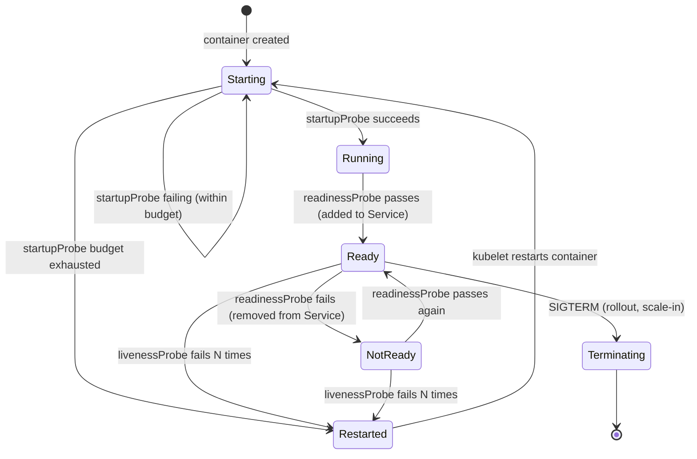
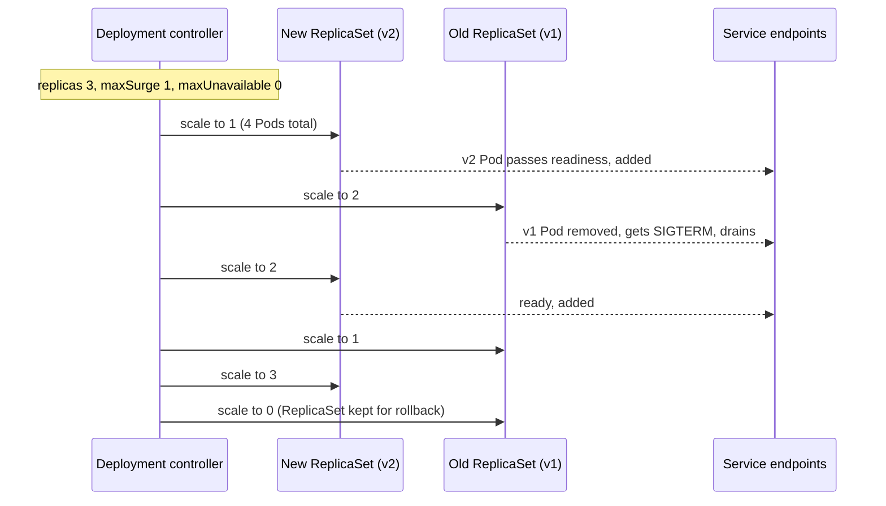

import { Tabs, TabItem, Aside } from '@astrojs/starlight/components';
import QuizBlock from '~/components/QuizBlock.astro';

## Why it matters in interviews

Once the basics are clear, interviewers probe whether you have actually run services on Kubernetes: *"liveness vs readiness?"*, *"your Pods keep restarting with OOMKilled, what now?"*, *"how do you deploy without dropping requests?"*, *"how does autoscaling decide?"*, *"how do you roll back?"*. This page is the practical half: the manifests and the reasoning behind each setting.

## Core idea

A production-ready workload needs five things on top of a plain Deployment: **health probes** so Kubernetes knows when to route traffic and when to restart, **resource requests and limits** so the scheduler can place Pods and noisy neighbours are contained, **autoscaling**, a **safe rollout strategy** with graceful shutdown, and **repeatable packaging** (Helm or Kustomize) per environment.

### Probes mapped to ASP.NET Core health checks

| Probe | Question it answers | On failure | ASP.NET Core endpoint |
|---|---|---|---|
| **startupProbe** | "Has the app finished starting?" Liveness and readiness are paused until it succeeds | Container restarted after `failureThreshold` × `periodSeconds` | `/health/live` (process is up) |
| **livenessProbe** | "Is the process stuck and in need of a restart?" | Container **restarted** | `/health/live`: only checks the app itself, **never dependencies** |
| **readinessProbe** | "Can this Pod serve traffic right now?" | Pod **removed from Service endpoints**, not restarted | `/health/ready`: checks DB, Redis, warm caches |

If liveness checked the database, a database outage would make every Pod fail liveness and restart in a loop, turning a partial outage into a full one. Readiness is the right place for dependencies: Pods stop receiving traffic, then return when the dependency recovers.



### Requests, limits and QoS

- **Requests** are what the scheduler reserves: a Pod is only placed on a node with that much unreserved CPU and memory. HPA utilisation percentages are calculated against requests.
- **Limits** cap usage. Exceeding the **memory limit** gets the container **OOMKilled**. Exceeding the **CPU limit** gets it **throttled** (slower, not killed), which shows up as latency spikes.
- **QoS class**: requests = limits for every container gives **Guaranteed**; requests lower than limits gives **Burstable**; nothing set gives **BestEffort**, the first to be evicted under node pressure.
- **.NET in containers** respects cgroup limits: `Environment.ProcessorCount` reflects the CPU limit, and with a memory limit the GC heap hard limit defaults to 75% of it. A common recommendation is memory request = memory limit, a CPU request, and either no CPU limit or a generous one to avoid throttling.

### Autoscaling

| Scaler | Scales | Based on |
|---|---|---|
| **HorizontalPodAutoscaler** (`autoscaling/v2`) | Number of Pods | CPU / memory utilisation vs requests, custom or external metrics. Needs metrics-server (AKS installs it; on EKS add it) |
| **KEDA** | Pods, including to zero | Event sources: queue length (Service Bus, SQS, Kafka), cron, HTTP |
| **Cluster autoscaler** / node auto-provisioning (Karpenter on EKS) | Number of nodes | Pods that are pending because no node has room |
| **VerticalPodAutoscaler** | Requests of a Pod | Observed usage (recommendations) |

HPA's core formula: `desiredReplicas = ceil(currentReplicas × currentMetric / targetMetric)`. With 4 Pods at 90% CPU and a 60% target: ceil(4 × 90 / 60) = 6.

### Rolling updates and graceful shutdown



When a Pod is terminated, Kubernetes removes it from endpoints and sends `SIGTERM` **at about the same time**, so a few requests can still arrive after the signal. ASP.NET Core handles `SIGTERM` by stopping new connections and waiting for in-flight requests (`HostOptions.ShutdownTimeout`, 30 seconds by default since .NET 8). A short **preStop** delay lets endpoint removal propagate first. `terminationGracePeriodSeconds` (default 30) must exceed preStop + shutdown time, or the kubelet sends `SIGKILL`.

## Code

### Health check endpoints in Program.cs

```csharp
builder.Services.AddHealthChecks()
    .AddCheck("self", () => HealthCheckResult.Healthy(), tags: ["live"])
    .AddDbContextCheck<AppDbContext>(tags: ["ready"]);   // package ...HealthChecks.EntityFrameworkCore
    // Redis etc.: AspNetCore.HealthChecks.Redis (community package), tagged "ready"

var app = builder.Build();

app.MapHealthChecks("/health/live", new HealthCheckOptions { Predicate = c => c.Tags.Contains("live") });
app.MapHealthChecks("/health/ready", new HealthCheckOptions { Predicate = c => c.Tags.Contains("ready") });
```

### API Deployment: probes, resources, security, rollout

```yaml
apiVersion: apps/v1
kind: Deployment
metadata:
  name: orders-api
  namespace: shop
  labels: { app: orders-api }
spec:
  replicas: 3
  revisionHistoryLimit: 5
  selector:
    matchLabels: { app: orders-api }
  strategy:
    type: RollingUpdate
    rollingUpdate: { maxSurge: 1, maxUnavailable: 0 }   # never below 3 ready Pods
  template:
    metadata:
      labels: { app: orders-api }
    spec:
      terminationGracePeriodSeconds: 45
      securityContext: { runAsNonRoot: true }
      containers:
        - name: api
          image: shopacr.azurecr.io/orders-api:1.4.2
          ports: [{ containerPort: 8080 }]
          envFrom: [{ configMapRef: { name: orders-api-config } }]
          env:
            - name: ConnectionStrings__Sql
              valueFrom: { secretKeyRef: { name: orders-api-secrets, key: sql-connection } }
          resources:
            requests: { cpu: 250m, memory: 256Mi }
            limits: { memory: 512Mi }                   # no CPU limit: avoid throttling
          startupProbe:
            httpGet: { path: /health/live, port: 8080 }
            periodSeconds: 2
            failureThreshold: 30                        # up to 60 s to start
          livenessProbe:
            httpGet: { path: /health/live, port: 8080 }
            periodSeconds: 10
            failureThreshold: 3
          readinessProbe:
            httpGet: { path: /health/ready, port: 8080 }
            periodSeconds: 5
            failureThreshold: 2
          lifecycle:
            preStop: { sleep: { seconds: 5 } }          # built-in sleep, works without a shell
          securityContext:
            allowPrivilegeEscalation: false
            readOnlyRootFilesystem: true
            capabilities: { drop: ["ALL"] }
          volumeMounts: [{ name: tmp, mountPath: /tmp }]
      volumes: [{ name: tmp, emptyDir: {} }]
```

The `preStop.sleep` action is built into recent Kubernetes versions; on older clusters use `exec: { command: ["sleep", "5"] }`, which requires a shell utility in the image (not available in chiseled images).

### Angular (nginx) Deployment and Service

```yaml
apiVersion: apps/v1
kind: Deployment
metadata: { name: shop-web, namespace: shop }
spec:
  replicas: 2
  selector: { matchLabels: { app: shop-web } }
  template:
    metadata: { labels: { app: shop-web } }
    spec:
      containers:
        - name: web
          image: shopacr.azurecr.io/shop-web:1.4.2
          ports: [{ containerPort: 8080 }]              # nginx-unprivileged
          readinessProbe: { httpGet: { path: /, port: 8080 }, periodSeconds: 10 }
          resources:
            requests: { cpu: 50m, memory: 64Mi }
            limits: { memory: 128Mi }
          volumeMounts:                                  # per-environment runtime config
            - { name: config, mountPath: /usr/share/nginx/html/config.json, subPath: config.json }
      volumes:
        - name: config
          configMap: { name: shop-web-config }
---
apiVersion: v1
kind: Service
metadata: { name: shop-web, namespace: shop }
spec:
  selector: { app: shop-web }
  ports: [{ port: 80, targetPort: 8080 }]
```

### HPA and PodDisruptionBudget

```yaml
apiVersion: autoscaling/v2
kind: HorizontalPodAutoscaler
metadata: { name: orders-api, namespace: shop }
spec:
  scaleTargetRef: { apiVersion: apps/v1, kind: Deployment, name: orders-api }
  minReplicas: 3
  maxReplicas: 10
  metrics:
    - type: Resource
      resource:
        name: cpu
        target: { type: Utilization, averageUtilization: 70 }   # % of the CPU request
  behavior:
    scaleDown: { stabilizationWindowSeconds: 300 }            # avoid flapping
---
apiVersion: policy/v1
kind: PodDisruptionBudget
metadata: { name: orders-api, namespace: shop }
spec:
  minAvailable: 2                    # node drains/upgrades keep at least 2 Pods
  selector: { matchLabels: { app: orders-api } }
```

When an HPA manages a Deployment, remove `replicas` from the Deployment manifest (or stop applying it), otherwise every `kubectl apply` resets the replica count.

### Rollouts and rollbacks

```bash
kubectl -n shop set image deployment/orders-api api=shopacr.azurecr.io/orders-api:1.5.0
kubectl -n shop rollout status deployment/orders-api      # waits; non-zero exit on failure
kubectl -n shop rollout history deployment/orders-api
kubectl -n shop rollout undo deployment/orders-api        # back to previous ReplicaSet
kubectl -n shop rollout undo deployment/orders-api --to-revision=3
kubectl -n shop rollout restart deployment/orders-api     # re-create Pods, e.g. after a Secret change
```

A rollout with a failing readiness probe **stalls** instead of taking the service down (with `maxUnavailable: 0` the old Pods keep serving). `progressDeadlineSeconds` (default 600) marks it as failed so the pipeline's `rollout status` fails.

### StatefulSet basics

```yaml
apiVersion: apps/v1
kind: StatefulSet
metadata: { name: redis, namespace: shop }
spec:
  serviceName: redis                 # headless Service gives redis-0.redis DNS names
  replicas: 1
  selector: { matchLabels: { app: redis } }
  template:
    metadata: { labels: { app: redis } }
    spec:
      containers:
        - name: redis
          image: redis:7-alpine
          ports: [{ containerPort: 6379 }]
          volumeMounts: [{ name: data, mountPath: /data }]
  volumeClaimTemplates:              # one PersistentVolumeClaim per Pod, kept on rescheduling
    - metadata: { name: data }
      spec:
        accessModes: [ReadWriteOnce]
        resources: { requests: { storage: 5Gi } }
```

StatefulSets give each Pod a **stable name** (`redis-0`), **stable storage** and **ordered** start and stop. In the cloud, prefer managed services (Azure SQL, Azure Managed Redis; AWS RDS, ElastiCache) for production data and keep StatefulSets for things you must self-host.

### Helm

Helm packages manifests as a **chart**: templates plus a `values.yaml`, installed as a versioned **release** you can upgrade and roll back. Kustomize (built into `kubectl apply -k`) is the template-free alternative using overlays per environment.

```yaml
# charts/orders-api/values.yaml (defaults; override per environment with -f values.prod.yaml)
image:
  repository: shopacr.azurecr.io/orders-api
  tag: "1.4.2"
replicaCount: 3
resources:
  requests: { cpu: 250m, memory: 256Mi }
  limits: { memory: 512Mi }
# templates/deployment.yaml uses: image: "{{ .Values.image.repository }}:{{ .Values.image.tag }}"
```

```bash
helm upgrade --install orders-api ./charts/orders-api -n shop --create-namespace \
  -f values.prod.yaml --set image.tag=1.5.0 --wait --atomic   # --atomic rolls back on failure
helm list -n shop
helm history orders-api -n shop
helm rollback orders-api 4 -n shop
helm template ./charts/orders-api -f values.prod.yaml        # render locally, review the YAML
```

### AKS (and EKS) specifics

```bash
az aks create -g rg-shop -n aks-shop --node-count 3 \
  --enable-cluster-autoscaler --min-count 3 --max-count 6 \
  --attach-acr shopacr --enable-oidc-issuer --enable-workload-identity
az aks get-credentials -g rg-shop -n aks-shop
```

| Concern | AKS | EKS |
|---|---|---|
| Registry pull | `--attach-acr` grants the kubelet identity AcrPull | ECR with node IAM role |
| Pod identity to cloud APIs | Microsoft Entra **Workload Identity** | IRSA / EKS Pod Identity |
| Secrets from vault | Key Vault **Secrets Store CSI driver** add-on | Secrets Manager CSI provider / External Secrets |
| HTTP ingress | Application routing add-on (managed NGINX), Application Gateway for Containers | AWS Load Balancer Controller (ALB) |
| Node scaling | Cluster autoscaler, node auto-provisioning | Cluster autoscaler, Karpenter |
| Monitoring | Container Insights, Managed Prometheus + Grafana | CloudWatch Container Insights, Managed Prometheus |
| Networking | Azure CNI (overlay) | Amazon VPC CNI |

## Interview Q&A

<details>
<summary>Liveness vs readiness vs startup probe?</summary>

Startup: "has the app finished booting?"; it holds off the other probes so slow starts are not killed. Liveness: "is the process wedged?"; failure restarts the container, so it must only check the process itself. Readiness: "can it take traffic now?"; failure removes the Pod from Service endpoints without restarting, so it is where dependency checks belong. In ASP.NET Core, map them to tagged health check endpoints such as `/health/live` and `/health/ready`.
</details>

<details>
<summary>Pods keep getting OOMKilled. What do you do?</summary>

`kubectl describe pod` shows `Last State: Terminated, Reason: OOMKilled`. Compare actual usage (`kubectl top pod`, Container Insights) with the memory limit. Either the limit is too low for the real workload, or there is a leak (dump with `dotnet-dump`, check caches without size limits, undisposed objects). Raise the limit with evidence, set request = limit for memory, and check the GC settings; the .NET GC sizes its heap from the container limit.
</details>

<details>
<summary>What happens if you set CPU limits too low?</summary>

The container is throttled by the CFS quota: it is not killed but gets slower, causing latency spikes and possibly failing probes, which then causes restarts. `Environment.ProcessorCount` also drops, shrinking thread pool and server GC heaps. Many teams set CPU requests and leave CPU limits off or generous.
</details>

<details>
<summary>How does a rolling update avoid downtime, and when does it still drop requests?</summary>

New Pods are created and only receive traffic after readiness passes; old Pods are removed gradually according to `maxSurge` and `maxUnavailable`. Requests can still fail if readiness is missing (traffic reaches Pods that are not ready), if the app does not drain on `SIGTERM`, or because endpoint removal and `SIGTERM` happen concurrently. Fix with readiness probes, a short preStop delay and an adequate `terminationGracePeriodSeconds`.
</details>

<details>
<summary>How does the HPA decide how many Pods to run?</summary>

Every 15 seconds by default it reads metrics (CPU from metrics-server, or custom metrics), computes `ceil(current × actual / target)`, clamps between min and max replicas, and applies stabilisation windows (scale-down waits 5 minutes by default) to avoid flapping. CPU utilisation is relative to the Pod's **request**, so no request means the HPA cannot compute utilisation.
</details>

<details>
<summary>How do you roll back a bad deployment?</summary>

`kubectl rollout undo deployment/orders-api` scales the previous ReplicaSet back up (kept according to `revisionHistoryLimit`). With Helm, `helm rollback <release> <revision>`, or deploy with `--atomic` to roll back automatically on failure. In a GitOps setup (Argo CD, Flux) you revert the commit. Database changes must be backward compatible for any rollback to be safe.
</details>

<details>
<summary>Deployment vs StatefulSet?</summary>

Deployment Pods are interchangeable: random names, shared or no storage, any order. StatefulSet Pods have stable identities (`db-0`), stable per-Pod persistent volumes and ordered rollout, which clustered databases and brokers need. For a stateless .NET API, always a Deployment.
</details>

<details>
<summary>Why Helm, and what are its downsides?</summary>

It packages an application's manifests with parameters, gives versioned releases, upgrade, rollback and dependency charts (for example a Redis chart). Downsides: Go templates in YAML are hard to read and debug, and a chart can hide what is actually deployed; render with `helm template` and review. Kustomize is a simpler alternative for small sets of per-environment differences.
</details>

<details>
<summary>How does a Pod on AKS read a secret from Key Vault without a password?</summary>

Enable the OIDC issuer and Workload Identity on the cluster, create a managed identity with a federated credential trusting the Pod's Kubernetes service account, and grant that identity access to Key Vault. The Pod's service account token is exchanged for an Entra token, so `DefaultAzureCredential` in the app (or the Secrets Store CSI driver) can read secrets. EKS equivalent: IRSA or EKS Pod Identity with IAM roles.
</details>

## Pitfalls

<Aside type="caution" title="Common mistakes">

- **Checking the database in the liveness probe**: a DB blip restarts every Pod.
- **No readiness probe**: traffic reaches Pods still warming up and during shutdown.
- **No resource requests**: bad scheduling, and HPA cannot compute CPU utilisation.
- **Tight CPU limits** causing throttling and probe failures.
- **`replicas` in the Deployment while an HPA manages it**, so each apply resets the scale.
- **`terminationGracePeriodSeconds` shorter than the app's shutdown**, so in-flight requests are killed.
- **Rolling out with `maxUnavailable` > 0 and only 2 replicas**, leaving one Pod to absorb all traffic.
- **Running EF Core migrations from every Pod at startup** instead of a Job or pipeline step.
- **Updating a ConfigMap or Secret and expecting env vars to change**: they are read at container start; restart the rollout (mounted files update after a delay).

</Aside>

## Related

- [Kubernetes core concepts](../kubernetes-core/)
- [Dockerising .NET & Angular](../docker-dotnet-angular/)
- [Rate limiting & health checks](../../aspnet/rate-limiting-health-checks/)
- [Reliability patterns](../../microservices/reliability-patterns/)

## Quick quiz

<QuizBlock section="testing-devops" topic="kubernetes-operations" />
