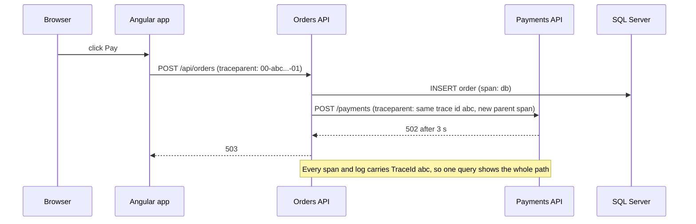
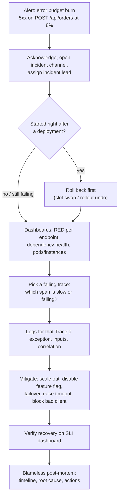

import { Tabs, TabItem, Aside } from '@astrojs/starlight/components';
import QuizBlock from '~/components/QuizBlock.astro';

## Why it matters in interviews

*"Production is slow, users are complaining. What do you do?"* is a favourite scenario question, and *"how would you know your service is unhealthy before customers tell you?"* follows close behind. Interviewers want to hear about structured logs, metrics, distributed traces with correlation, dashboards and SLO-based alerts, and a calm, ordered incident process. This page covers the operational side; the ASP.NET Core logging APIs are on [Logging & observability](../../aspnet/logging-observability/).

## Core idea

**Monitoring** tells you *that* something is wrong (known failure modes, dashboards, alerts). **Observability** is the ability to ask *why* from the outside, including questions you did not plan for, using the telemetry the system emits.

### The three pillars

| Signal | What it is | Good for | Cost profile | .NET source |
|---|---|---|---|---|
| **Logs** | Timestamped, structured events (`Order {OrderId} failed`) | Details of one specific event, errors, audit | Expensive at volume; sample or reduce levels | `ILogger` |
| **Metrics** | Numeric time series with dimensions (requests/s, p95 latency, queue length) | Dashboards, alerts, trends; cheap to store | Cheap, but watch high-cardinality labels | `System.Diagnostics.Metrics` (`Meter`, `Counter`, `Histogram`) |
| **Traces** | A tree of **spans** following one request across services | Where time goes, which dependency failed | Medium; usually sampled | `System.Diagnostics.Activity` / `ActivitySource` |

They are linked by **context**: every log written during a request carries the `TraceId` and `SpanId`, so from a slow trace you jump to its logs, and from an error log to its full trace. Across services the context travels in the **W3C `traceparent` HTTP header** (and in message properties for queues), which `HttpClient` and ASP.NET Core propagate automatically.



### OpenTelemetry

**OpenTelemetry (OTel)** is the vendor-neutral standard for producing and exporting telemetry: APIs, SDKs, automatic instrumentation for ASP.NET Core, `HttpClient`, SQL clients and more, and the **OTLP** protocol. You instrument once and export to any backend: Azure Monitor / Application Insights, AWS (CloudWatch and X-Ray through the AWS Distro for OpenTelemetry), Grafana stack (Prometheus, Loki, Tempo), Jaeger, Datadog, Elastic. The **.NET Aspire dashboard** shows OTLP data locally during development.

Microsoft's recommended way to send .NET telemetry to Application Insights is now the **Azure Monitor OpenTelemetry Distro** (`Azure.Monitor.OpenTelemetry.AspNetCore`, `UseAzureMonitor()`). An OpenTelemetry **Collector** can sit in between to batch, filter, sample and fan out to several backends.

### What to put on a dashboard

| Method | For | Signals |
|---|---|---|
| **RED** | Request-driven services (APIs) | **R**ate, **E**rrors, **D**uration (p50, p95, p99) |
| **USE** | Resources (CPU, memory, DB, queues) | **U**tilisation, **S**aturation, **E**rrors |
| **Four golden signals** (Google SRE) | Any user-facing system | Latency, traffic, errors, saturation |

Use **percentiles, not averages**: an average of 200 ms can hide a p99 of 5 s that a few percent of users suffer every day.

### SLI, SLO, SLA and error budgets

- **SLI** (indicator): a measured ratio, e.g. *proportion of `GET /api/orders` requests that succeed in under 300 ms*.
- **SLO** (objective): the internal target for an SLI, e.g. *99.9% over 30 days*.
- **SLA** (agreement): a contract with customers, with penalties; set looser than the SLO.
- **Error budget** = 100% − SLO. At 99.9% over 30 days you may "spend" 0.1% × 43,200 minutes = **43.2 minutes** of bad time. Budget left: ship features. Budget burnt: focus on reliability.

**Alert on symptoms, not causes.** Page someone when the error budget is burning fast (e.g. error rate high enough to exhaust the monthly budget in hours), not for every CPU spike. Every page should be actionable and link to a runbook; noisy alerts get ignored.

## Code

OpenTelemetry setup in `Program.cs`, exporting over OTLP (to a Collector, Aspire dashboard, Grafana, etc.):

```csharp
builder.Services.AddOpenTelemetry()
    .ConfigureResource(r => r.AddService("orders-api"))
    .WithTracing(t => t
        .AddAspNetCoreInstrumentation()
        .AddHttpClientInstrumentation()
        .AddSource("Orders.Api"))              // our own ActivitySource
    .WithMetrics(m => m
        .AddAspNetCoreInstrumentation()
        .AddHttpClientInstrumentation()
        .AddMeter("Orders.Api"))               // our own Meter
    .WithLogging()
    .UseOtlpExporter();                        // endpoint from OTEL_EXPORTER_OTLP_ENDPOINT

// Application Insights instead: package Azure.Monitor.OpenTelemetry.AspNetCore
// builder.Services.AddOpenTelemetry().UseAzureMonitor();  // APPLICATIONINSIGHTS_CONNECTION_STRING
```

Custom spans and metrics:

```csharp
public static class Telemetry
{
    public static readonly ActivitySource Source = new("Orders.Api");
}

public sealed class OrderMetrics
{
    private readonly Counter<long> _placed;
    private readonly Histogram<double> _value;

    public OrderMetrics(IMeterFactory meterFactory)          // register as a singleton
    {
        var meter = meterFactory.Create("Orders.Api");
        _placed = meter.CreateCounter<long>("orders.placed");
        _value = meter.CreateHistogram<double>("orders.value", unit: "EUR");
    }

    public void OrderPlaced(decimal total)
    {
        _placed.Add(1);
        _value.Record((double)total);
    }
}

// In a handler:
using var activity = Telemetry.Source.StartActivity("ReserveStock"); // null if nobody listens
activity?.SetTag("order.id", order.Id);
```

Structured, high-performance logging with the source generator; properties become queryable fields, not just text:

```csharp
public static partial class Log
{
    [LoggerMessage(Level = LogLevel.Warning,
        Message = "Payment for order {OrderId} failed after {Attempts} attempts")]
    public static partial void PaymentFailed(this ILogger logger, int orderId, int attempts);
}

logger.PaymentFailed(order.Id, attempts);     // never: logger.LogWarning($"Payment {id} failed")
```

Querying Application Insights with KQL (Log Analytics):

```text
// Failure rate and p95 latency per operation, 5-minute buckets
requests
| where timestamp > ago(1h)
| summarize failures = countif(success == false), total = count(),
            p95 = percentile(duration, 95) by name, bin(timestamp, 5m)
| extend failureRate = 100.0 * failures / total
| order by failureRate desc

// Which dependency is failing?
dependencies
| where timestamp > ago(1h) and success == false
| summarize count() by target, type, resultCode
```

### Debugging a production incident: a walkthrough



A concrete story you can tell: *"p95 latency on checkout went from 300 ms to 4 s. The dashboard showed the API's CPU was low, but traces showed 3.5 s inside the `payments` HTTP span. Payments logs for those trace ids showed connection pool exhaustion after a config change reduced the pool size. We rolled the config back, latency recovered in five minutes, and the post-mortem added a pool-saturation metric, an alert, and a timeout plus circuit breaker on the payments client."*

## Interview Q&A

<details>
<summary>Logs vs metrics vs traces: when do you use which?</summary>

Metrics to detect and alert (cheap, aggregated: error rate, latency percentiles, saturation). Traces to locate where time is spent or which service failed for a request. Logs for the detailed context of a specific event (exception, parameters). In an incident you typically go metric → trace → logs, linked by trace id.
</details>

<details>
<summary>What is OpenTelemetry and why use it instead of a vendor SDK?</summary>

A CNCF standard for generating and exporting logs, metrics and traces, with automatic instrumentation for common libraries and the OTLP wire protocol. You instrument code once and can switch or combine backends (Application Insights, Grafana, Datadog, CloudWatch via ADOT) by changing exporters or Collector config, avoiding lock-in. .NET's own `ActivitySource` and `Meter` APIs are the OTel APIs for .NET.
</details>

<details>
<summary>How do you correlate a request across microservices?</summary>

W3C Trace Context: the `traceparent` header carries the trace id and parent span id. ASP.NET Core and `HttpClient` read and write it automatically when OTel (or Application Insights) is enabled; for queues, copy it into message properties (Azure Service Bus and MassTransit instrumentation do this). Include the trace id in logs and in error responses (ProblemDetails `traceId`) so support can find the trace.
</details>

<details>
<summary>What is the difference between an SLO and an SLA?</summary>

An SLO is an internal reliability target for a measured SLI, such as 99.9% of requests under 300 ms over 30 days. An SLA is an external contract that promises a level of service with penalties, usually looser than the SLO so you have a safety margin. The error budget (100% − SLO) tells the team how much unreliability it can afford.
</details>

<details>
<summary>Why are averages misleading for latency?</summary>

Latency distributions are long-tailed. A 200 ms average can hide 2% of requests taking 5 s, and in a page with many calls most users hit the tail at least once. Track p50, p95 and p99, and alert on the high percentiles that match your SLO.
</details>

<details>
<summary>What is high cardinality and why does it matter for metrics?</summary>

Cardinality is the number of unique label combinations. Adding a label like `userId` or `orderId` to a metric creates a time series per value, which explodes storage and cost and can break the metrics backend. Put such identifiers in logs and trace attributes, and keep metric dimensions bounded (endpoint, status code, region).
</details>

<details>
<summary>Production is slow. Walk me through your approach.</summary>

Confirm the impact on SLI dashboards (which endpoints, since when, how many users). Check recent changes and roll back if correlated. Use traces to find which span dominates the latency, then logs and dependency metrics for that component (DB DTU or query plans, pool exhaustion, thread pool starvation, GC). Mitigate first (rollback, scale, feature flag), verify recovery, then root-cause and a blameless post-mortem with follow-up actions.
</details>

## Pitfalls

<Aside type="caution" title="Common mistakes">

- **String-interpolated log messages** (`$"Order {id}"`): no structured fields, and the string is built even when the level is disabled.
- **Logging secrets or personal data** (tokens, passwords, full card numbers).
- **High-cardinality metric labels** such as user ids.
- **Alerting on causes** (CPU above 80%) instead of user-facing symptoms, leading to alert fatigue.
- **Averages instead of percentiles** for latency.
- **No trace id in error responses**, so support cannot find the request.
- **100% trace sampling at high volume** without considering cost; sample, but keep all errors.
- **Debug-level logging left on in production**, driving up ingestion costs.

</Aside>

## Related

- [Logging & observability in ASP.NET Core](../../aspnet/logging-observability/)
- [Observability across microservices](../../microservices/observability-cross-cutting/)
- [Kubernetes in practice](../kubernetes-operations/)
- [Deploying to Azure (and AWS)](../cloud-deployment/)

## Quick quiz

<QuizBlock section="testing-devops" topic="observability" />
