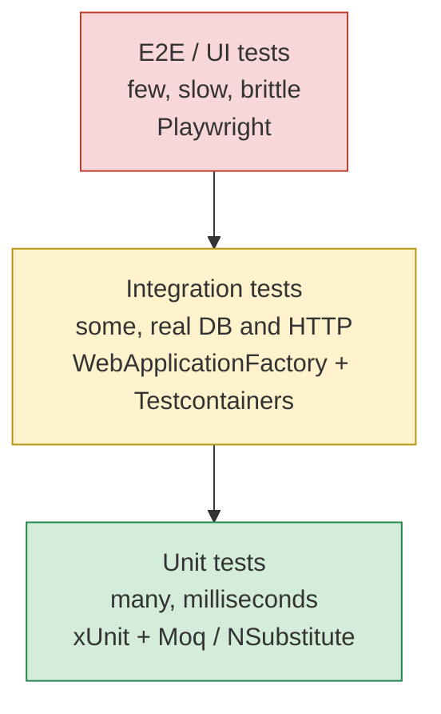
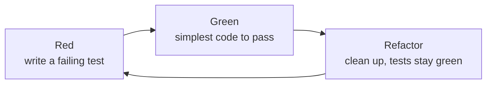

import { Tabs, TabItem, Aside } from '@astrojs/starlight/components';
import QuizBlock from '~/components/QuizBlock.astro';

## Why it matters in interviews

*"How do you test your code?"* comes up in almost every SDE interview, often as a follow-up to a design or coding round. Interviewers want to hear a **strategy**: which kinds of tests you write, why, and what you deliberately do not test. A 3-4 year engineer is expected to explain the pyramid, pick the right test double, and talk about flaky tests and coverage without repeating myths.

## Core idea

A test suite exists to give you **confidence to change code quickly**. Every test has a cost (writing it, running time, maintenance, flakiness) and a value (bugs it catches, design feedback, living documentation). A good strategy puts most tests where they are cheap and fast, and only a few where they are slow and brittle.

### The test pyramid



| Level | What it exercises | Speed | Typical tools (.NET / Angular) | Catches |
|---|---|---|---|---|
| **Unit** | One class or function, slow dependencies replaced by doubles | ms | xUnit, NUnit, MSTest, Moq, NSubstitute / Vitest, Jasmine | Logic bugs, edge cases |
| **Integration** | Several real components: API + EF Core + real SQL Server | 100 ms to seconds | `WebApplicationFactory`, Testcontainers, Respawn | Wiring, SQL, serialization, DI, auth config |
| **Contract** | The shape of an API agreed between consumer and provider | fast | Pact, OpenAPI diff | Breaking API changes between teams |
| **E2E** | Whole system through the browser | seconds to minutes | Playwright, Cypress | Broken user journeys, deployment config |

### Pyramid vs trophy

The **testing trophy** (popularised by Kent C. Dodds) argues for **more integration tests than unit tests**, because integration tests catch the bugs users actually hit while still running fast enough. At its base it adds **static analysis** (TypeScript, nullable reference types, Roslyn analyzers) as the cheapest layer of all.

In practice for a .NET API: unit-test the **domain logic** that has real branching (pricing, validation, state machines), and integration-test **endpoints** through the full HTTP pipeline against a real database in a container. Thin CRUD controllers get little value from mock-heavy unit tests.

### What counts as a "unit"?

- **London (mockist) school**: a unit is one class; mock every collaborator. Very isolated, but tests are coupled to implementation details.
- **Classical (Detroit) school**: a unit is a **unit of behaviour**, possibly several classes. Only replace dependencies that are slow, shared or non-deterministic (database, HTTP, clock, file system). Tests survive refactoring better.

Most modern advice leans classical: *mock at the boundaries of your system, not between your own classes*.

### Anatomy of a good test: AAA and naming

**Arrange, Act, Assert** keeps each test readable. Test one logical behaviour per test; several `Assert` calls about the same outcome are fine.

Common naming styles:
- `MethodName_Scenario_ExpectedResult`, for example `CancelAsync_After24Hours_Throws`
- Sentence style, for example `Cancelling_an_order_after_24_hours_is_rejected`

Pick one per codebase. The name should tell you what broke without opening the test.

### Test doubles

| Double | What it does | Example | Verifies interactions? |
|---|---|---|---|
| **Dummy** | Passed in but never used | `NullLogger<T>.Instance` | No |
| **Stub** | Returns canned answers | `repo.FindAsync(1, ...).Returns(order)` | No |
| **Fake** | Working lightweight implementation | In-memory repository, `FakeTimeProvider` | No |
| **Spy** | Records calls for later inspection | `FakeEmailSender.Sent` list | Yes, by inspection |
| **Mock** | Pre-programmed with expectations that are verified | `notifier.Verify(..., Times.Once)` | Yes |

Moq and NSubstitute create objects that can act as either stubs or mocks. The distinction interviewers want: **stubs feed data in; mocks check side effects that leave the system** (an email sent, a message published). Verify interactions only when the interaction **is** the behaviour.

### TDD and BDD



- **TDD** (Test-Driven Development) is a design technique: the test is the first client of your API, so awkward dependencies show up immediately. It works best for logic with clear inputs and outputs, and for bug fixes (write the failing test that reproduces the bug first).
- **BDD** (Behaviour-Driven Development) writes scenarios in business language, `Given / When / Then`, often in Gherkin files. In .NET, **Reqnroll** is the community successor to SpecFlow, which has been retired. Even without Gherkin, naming tests as behaviours is the useful part.

### Flaky tests

A flaky test passes and fails on the same code. Common causes and fixes:

| Cause | Fix |
|---|---|
| `DateTime.Now`, time zones, `Task.Delay` | Inject `TimeProvider`, use `FakeTimeProvider` |
| Shared database state between tests | Reset with Respawn, unique data per test |
| Test order dependence, static state | Avoid statics; xUnit creates a new class instance per test |
| Async races, fixed sleeps in UI tests | Await the condition (Playwright auto-waits), never `Thread.Sleep` |
| Real external services | Fakes, WireMock.Net, Testcontainers |
| Parallel tests sharing ports or files | Random ports, temp directories |

Treat flakiness as a bug: quarantine the test, fix the root cause, and do not just add retries everywhere.

### Coverage myths

- **"100% coverage means no bugs."** Coverage shows which lines **ran**, not whether anything was asserted. A test with no assertions still adds coverage.
- **"Higher is always better."** Chasing the last 10% often produces tests of getters and framework code that slow down refactoring.
- **What actually helps:** use coverage to **find untested risky code**, keep a sensible floor on domain projects (often 70-80%), and consider **mutation testing** (Stryker.NET) which changes your code and checks that at least one test fails.

## Code

A behaviour-focused unit test with AAA, a stub for input and a mock for the output:

<Tabs syncKey="lang">
  <TabItem label="C#">
```csharp
public class OrderServiceTests
{
    [Fact]
    public async Task Cancelling_within_24_hours_notifies_the_customer()
    {
        // Arrange
        var ct = TestContext.Current.CancellationToken;
        var clock = new FakeTimeProvider(DateTimeOffset.UtcNow);
        var order = new ShopOrder(1, "a@b.com", clock.GetUtcNow());
        var repo = Substitute.For<IOrderRepository>();
        repo.FindAsync(1, Arg.Any<CancellationToken>()).Returns(order); // stub
        var notifier = Substitute.For<INotifier>();                      // mock
        var sut = new OrderService(repo, notifier, clock);

        // Act
        await sut.CancelAsync(1, ct);

        // Assert
        Assert.Equal(OrderStatus.Cancelled, order.Status);
        await notifier.Received(1).SendAsync("a@b.com", "Order cancelled", Arg.Any<CancellationToken>());
    }
}
```
  </TabItem>
  <TabItem label="TypeScript">
```ts
// Same AAA shape in an Angular/Vitest unit test of a pure function.
import { describe, it, expect } from 'vitest';
import { discountRate } from './pricing';

describe('discountRate', () => {
  it.each([
    [100, 0],
    [500, 0.05],
    [1500, 0.1],
  ])('returns the tier for a total of %d', (total, expected) => {
    // Arrange is the table row; Act + Assert:
    expect(discountRate(total)).toBe(expected);
  });
});
```
  </TabItem>
</Tabs>

A Gherkin scenario (Reqnroll binds each line to a C# step method):

```text
Feature: Order cancellation
  Scenario: Customer cancels a recent order
    Given an order placed 2 hours ago
    When the customer cancels it
    Then the order status is "Cancelled"
    And the customer receives a cancellation email
```

## Interview Q&A

<details>
<summary>Explain the test pyramid. Do you follow it strictly?</summary>

Many fast unit tests at the bottom, fewer integration tests in the middle, a handful of e2e tests at the top, because cost and flakiness grow as you go up. I use it as a guide, not a rule: for a CRUD-heavy API I write more integration tests (WebApplicationFactory + Testcontainers) and keep unit tests for real domain logic. That is closer to the testing trophy.
</details>

<details>
<summary>Mock vs stub: what is the difference?</summary>

A **stub** provides canned answers so the code under test can run; you do not assert on it. A **mock** carries expectations that you **verify**: "SendAsync was called once with this address". Use mocks for outgoing side effects that are the point of the behaviour, and stubs for incoming data. Verifying calls on stubs couples tests to implementation.
</details>

<details>
<summary>What should you not unit test?</summary>

Framework code (EF Core, ASP.NET Core routing), trivial getters and setters, private methods directly (test them through the public API), and third-party libraries. Mapping, DI wiring and configuration are better covered by integration tests.
</details>

<details>
<summary>How do you deal with a flaky test in CI?</summary>

Reproduce it (run it in a loop, run in parallel, look at timing and shared state), quarantine it so it does not block the team, then fix the root cause: inject `TimeProvider`, isolate test data, replace sleeps with awaited conditions. Automatic retries are acceptable for e2e as a safety net, but retried tests should be reported and tracked.
</details>

<details>
<summary>Is 100% code coverage a good goal?</summary>

No. Coverage measures executed lines, not verified behaviour. I use it to spot untested risky areas and keep a reasonable floor on domain code. Mutation testing (Stryker.NET) is a better signal of test quality.
</details>

<details>
<summary>Do you practise TDD?</summary>

Answer honestly. A good answer: "I use TDD for business rules and bug fixes: first a failing test that reproduces the bug, then the fix. For exploratory UI work I write tests once the design settles." The key benefit is design feedback: hard-to-test code usually has too many dependencies.
</details>

<details>
<summary>What is the difference between integration and e2e tests?</summary>

Integration tests check that a few real components work together, for example the API pipeline plus a real SQL Server, usually in-process and without a browser. E2E tests drive the **deployed** application through its UI like a user, covering frontend, backend, configuration and infrastructure together.
</details>

## Pitfalls

<Aside type="caution" title="Common mistakes">

- **Mocking everything**, including your own value objects and internal helpers. Tests break on every refactor.
- **Testing implementation, not behaviour**: verifying internal call order instead of observable results.
- **Shared mutable state** between tests (static fields, a shared database without reset).
- **`DateTime.Now` / `Guid.NewGuid()`** hard-coded in logic. Inject `TimeProvider` or an abstraction.
- **No assertion**, or asserting only that no exception was thrown.
- **Using coverage as a target** instead of a diagnostic.
- **Huge e2e suites** that take an hour and fail randomly, so nobody trusts the build.

</Aside>

## Related

- [Unit testing in .NET](../dotnet-unit-testing/)
- [Integration testing in .NET](../dotnet-integration-testing/)
- [End-to-end testing](../e2e-testing/)
- [Angular testing](../../angular/testing/)

## Quick quiz

<QuizBlock section="testing-devops" topic="testing-strategy" />
