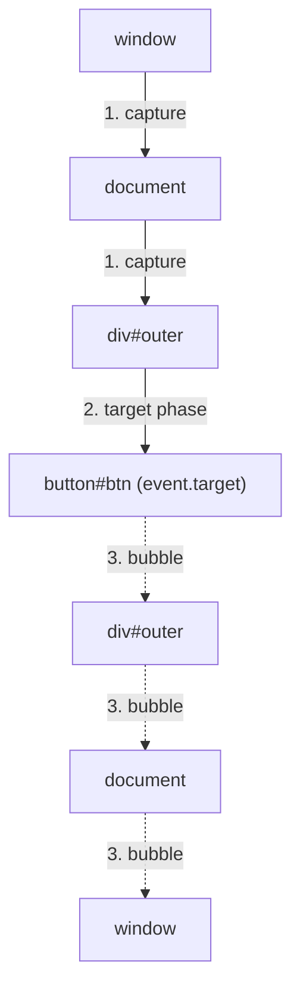
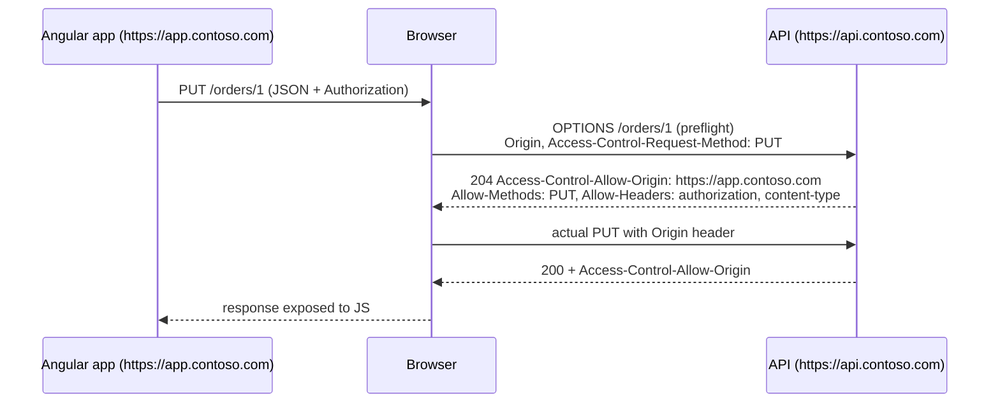
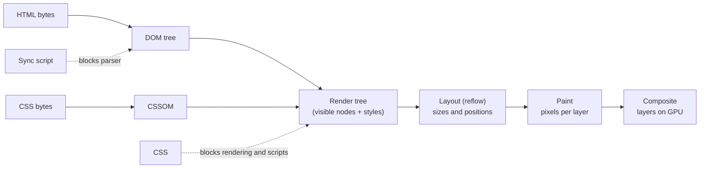

import { Tabs, TabItem, Aside } from '@astrojs/starlight/components';
import QuizBlock from '~/components/QuizBlock.astro';

## Why it matters in interviews

Full-stack .NET + Angular candidates get browser questions from both directions: *"where do you store the JWT?"*, *"the API works in Postman but fails in the browser, why?"*, *"what is event delegation?"*, *"why is this page janky?"*. Good answers connect browser mechanics to concrete Angular and ASP.NET Core settings.

## Core idea

### DOM events: capture, target, bubble

When you click a button, the event does not just fire on the button. It travels **down** from `window` to the target (capture phase), fires on the target, then travels **back up** (bubble phase). `addEventListener` listens in the bubble phase by default; pass `{ capture: true }` to listen on the way down.



```js
outer.addEventListener('click', () => console.log('outer bubble'));
outer.addEventListener('click', () => console.log('outer capture'), { capture: true });
btn.addEventListener('click', () => console.log('btn'));
document.addEventListener('click', () => console.log('document bubble'));
btn.click();
// outer capture, btn, outer bubble, document bubble
```

| Method | Effect |
|---|---|
| `event.stopPropagation()` | stop travelling to further elements; other listeners on the **current** element still run |
| `event.stopImmediatePropagation()` | also skip remaining listeners on the current element |
| `event.preventDefault()` | cancel the browser's default action (form submit, link navigation, checkbox toggle); propagation continues |

`event.target` is the element that was actually clicked (maybe a `<span>` inside your button); `event.currentTarget` is the element whose listener is running. Some events don't bubble (`focus`, `blur`, `mouseenter`, `mouseleave`); use `focusin`/`focusout` when you need bubbling.

Useful listener options: `{ once: true }` auto-removes after the first call, `{ passive: true }` promises not to call `preventDefault` (lets the browser scroll without waiting on touch/wheel handlers), and `{ signal }` removes the listener when an `AbortController` aborts.

### Event delegation

Instead of one listener per row, put **one listener on the container** and find the row from `event.target`. It uses less memory, and it works for rows added later.

```js
list.addEventListener('click', (e) => {
  const row = e.target.closest('li[data-id]');   // walk up from what was clicked
  if (!row || !list.contains(row)) return;
  openOrder(row.dataset.id);
});
```

In Angular, `(click)` on an element inside `@for` attaches a listener per element, which is fine for normal lists. For very large tables, a single `(click)` on the container with `closest()` is a valid optimisation. `@HostListener('document:keydown.escape')` or `host: { '(document:click)': ... }` listens globally, and Angular removes it when the component is destroyed.

### Storage options

| | Cookie | `localStorage` | `sessionStorage` | IndexedDB |
|---|---|---|---|---|
| Capacity | about 4 KB per cookie | about 5 MB per origin (browser-dependent) | about 5 MB | large (a share of disk) |
| Lifetime | session or `Expires`/`Max-Age` | until cleared | until the **tab** closes (survives reload) | until cleared |
| Scope | domain + path, sent to server | origin, all tabs | origin **and** tab | origin, all tabs |
| Sent with HTTP requests | **yes, automatically** | no | no | no |
| Readable by JS | yes, unless `HttpOnly` | yes | yes | yes |
| API | `document.cookie` string | sync, strings only | sync, strings only | async, structured data, indexes, transactions |

**Where to keep tokens?** Anything JavaScript can read (`localStorage`, non-HttpOnly cookies, memory) can be stolen by an XSS bug. An `HttpOnly; Secure; SameSite=Lax/Strict` cookie can't be read by script, but because the browser sends it automatically you need CSRF protection. A common pattern is a short-lived access token in memory plus a refresh token in an HttpOnly cookie, or a BFF (backend-for-frontend) that keeps tokens server-side. Details: [Auth tokens](../../security/authn-authz-tokens/).

Other notes: `localStorage` is synchronous and blocks the main thread on large reads; the `storage` event fires in **other** tabs of the same origin when it changes (useful for "log out everywhere"); IndexedDB suits offline data and caches (usually via a wrapper like `idb` or Dexie).

### CORS from the browser side

The **same-origin policy** stops a page from reading responses from a different origin (scheme + host + port). **CORS** is how a server opts in. It is enforced **by the browser**, which is why the same request works in Postman or from a .NET service.



- **Simple requests** (GET, HEAD, or POST with `text/plain`, `multipart/form-data` or `application/x-www-form-urlencoded`, and only safelisted headers) skip the preflight. A JSON POST, any PUT/DELETE/PATCH, or an `Authorization` header triggers one.
- The request **still reaches the server** for simple requests; CORS only stops JavaScript from reading the response. CORS is not CSRF protection.
- **Credentials** (`withCredentials: true` in Angular, `credentials: 'include'` in fetch) require `Access-Control-Allow-Credentials: true` and an exact origin, never `*`.
- `Access-Control-Max-Age` caches preflights. Locally, the Angular dev-server proxy (`proxy.conf.json`) avoids CORS entirely by making the API same-origin.

Server side setup: [CORS in ASP.NET Core](../../aspnet/versioning-openapi-cors/).

### Critical rendering path



- CSS is **render-blocking**: the browser won't paint until the CSSOM is ready.
- A plain `<script>` is **parser-blocking**: HTML parsing stops while it downloads and runs. `defer` downloads in parallel and runs in order after parsing; `async` runs as soon as it downloads, in any order. Module scripts (`type="module"`, which Angular emits) are deferred by default.
- Optimisations: inline critical CSS, defer non-critical JS, preload key assets, lazy routes and `@defer` blocks, SSR/hydration for a faster first paint.

### Reflow vs repaint

| Change | Layout (reflow) | Paint | Composite only |
|---|---|---|---|
| `width`, `height`, `top`, font size, adding nodes | yes | yes | yes |
| `color`, `background`, `visibility` | no | yes | yes |
| `transform`, `opacity` (on own layer) | no | no | yes |

**Layout thrashing** happens when code alternates writes and reads of layout properties (`offsetHeight`, `getBoundingClientRect`) in a loop, forcing a synchronous layout each time. Batch reads first, then writes, or use `requestAnimationFrame`. Animate `transform` and `opacity`, not `top`/`left`.

### Web Workers

A Web Worker runs JavaScript on a **separate thread** with its own event loop and global scope. It can't touch the DOM; it talks to the page via `postMessage`, which copies data with the structured clone algorithm (or **transfers** an `ArrayBuffer` without copying). Use it for CPU-heavy work: parsing a big CSV, image processing, crypto, large sorts. Angular CLI scaffolds one with `ng generate web-worker`. A **service worker** is different: it is a network proxy for caching and offline support (Angular's `@angular/service-worker`), not for computation.

## Code

```ts
// Main thread: offload CSV parsing so the UI stays responsive.
const worker = new Worker(new URL('./csv.worker', import.meta.url), { type: 'module' });
worker.onmessage = ({ data }: MessageEvent<Row[]>) => rows.set(data);
worker.postMessage(fileText);

// csv.worker.ts
addEventListener('message', ({ data }: MessageEvent<string>) => {
  const rows = data.split('\n').map((line) => line.split(','));
  postMessage(rows);
});
```

```ts
// Avoiding layout thrashing: read all, then write all.
const items = [...document.querySelectorAll<HTMLElement>('.card')];
const heights = items.map((el) => el.offsetHeight);          // reads (1 layout)
items.forEach((el, i) => (el.style.minHeight = `${heights[i]}px`)); // writes
```

## Interview Q&A

<details>
<summary>Explain event bubbling and capturing.</summary>

An event travels from `window` down to the target (capture), fires on the target, then bubbles back up through ancestors. Listeners run in the bubble phase unless registered with `{ capture: true }`. Bubbling is what makes delegation possible; capture is useful to intercept events before children see them.
</details>

<details>
<summary>What is event delegation and when do you use it?</summary>

One listener on a common ancestor handles events from many children by inspecting `event.target` (usually with `closest()`). It saves memory on large lists and automatically covers elements added later. Watch out for events that don't bubble and for checking that the matched element is inside the container.
</details>

<details>
<summary>`stopPropagation` vs `preventDefault`?</summary>

`stopPropagation` stops the event from reaching other elements but doesn't cancel the default action. `preventDefault` cancels the default action (submitting a form, following a link) but the event keeps propagating. They are independent; use both if you need both.
</details>

<details>
<summary>localStorage vs sessionStorage vs cookies?</summary>

Cookies are small, sent to the server on every matching request, and can be `HttpOnly`. `localStorage` holds a few MB per origin, persists until cleared and is shared across tabs. `sessionStorage` is per tab and cleared when the tab closes. Both web storages are synchronous, strings only, and readable by any script on the origin, so never store secrets there if XSS is a concern.
</details>

<details>
<summary>The API works in Postman but the Angular app gets a CORS error. Why?</summary>

CORS is enforced by browsers, not servers or Postman. The browser sent a preflight (or the actual request) and the response lacked the right `Access-Control-Allow-*` headers for that origin, method or headers. Fix it on the API: allow the exact origin, methods and headers, and `AllowCredentials` if cookies are used. Check that CORS middleware runs before auth and that errors (500, 401) also carry CORS headers, or the browser hides the real error.
</details>

<details>
<summary>Describe the critical rendering path.</summary>

HTML is parsed into the DOM and CSS into the CSSOM; together they form the render tree, which goes through layout (geometry), paint (pixels) and composite (layers). CSS blocks rendering and sync scripts block parsing, so fast first paint means minimal critical CSS, deferred JS and small initial bundles.
</details>

<details>
<summary>What is the difference between reflow and repaint?</summary>

Reflow (layout) recalculates sizes and positions and is the expensive one; it can cascade through the tree. Repaint redraws pixels without changing geometry (colour change). `transform` and `opacity` changes can skip both and only re-composite, which is why they are preferred for animations.
</details>

<details>
<summary>Web Worker vs Service Worker?</summary>

A Web Worker is a background thread for CPU work, owned by a page, communicating via messages. A Service Worker is an event-driven proxy between the app and the network, shared by all pages in its scope, used for caching, offline mode and push notifications. Neither can access the DOM.
</details>

## Pitfalls

<Aside type="caution" title="Common mistakes">

- **Tokens in localStorage** without considering XSS; or cookies without SameSite/CSRF protection.
- **`AllowAnyOrigin` with credentials**: browsers reject `*` when credentials are included.
- **Assuming CORS protects the server.** It protects users' browsers; non-browser clients ignore it.
- **Listeners never removed** on `window`/`document` from components, leaking the component. Use Angular host listeners, `takeUntilDestroyed` or an `AbortSignal`.
- **Layout thrashing** from interleaved reads and writes in loops.
- **Large synchronous `localStorage` reads** at startup blocking the main thread.
- **`target` vs `currentTarget` confusion** in delegated handlers.

</Aside>

## Related

- [Event loop & promises](../js-event-loop/)
- [Web attacks: XSS, CSRF, CORS](../../security/web-attacks/)
- [Angular performance](../../angular/performance/)
- [HTTP & HTTPS fundamentals](../../fundamentals/http-https/)

## Quick quiz

<QuizBlock section="web" topic="browser-dom" />
