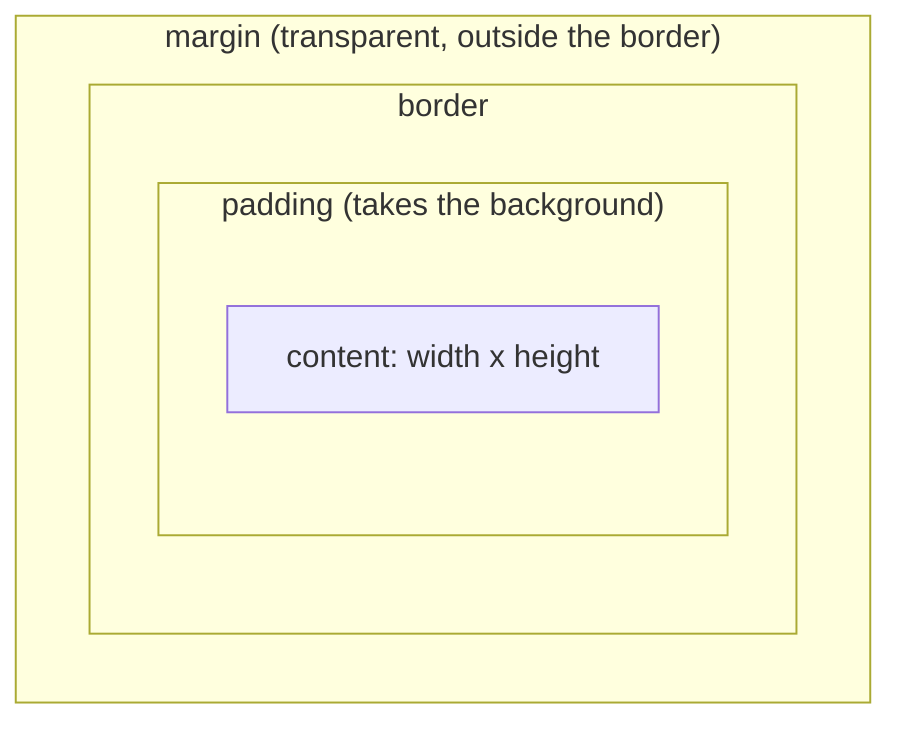

import { Tabs, TabItem, Aside } from '@astrojs/starlight/components';
import QuizBlock from '~/components/QuizBlock.astro';

## Why it matters in interviews

Full-stack candidates are rarely asked to hand-code a design, but *"flexbox or grid?"*, *"why is my style not applied?"* (specificity), *"why isn't `z-index` working?"* and *"how do component styles stay scoped in Angular?"* come up often. Live-coding rounds may ask you to centre something or build a responsive card grid in a few minutes.

## Core idea

### The box model

Every element is a rectangular box made of **content**, **padding**, **border** and **margin**.



`box-sizing` decides what `width` means:

| | `content-box` (default) | `border-box` |
|---|---|---|
| `width: 200px` applies to | content only | content + padding + border |
| `width: 200px; padding: 20px; border: 5px` renders as | 250 px wide | 200 px wide |

Most projects set `*, *::before, *::after { box-sizing: border-box; }` so widths behave predictably.

**Margin collapsing:** vertical margins of adjacent block elements (and of a parent and its first/last child) combine into the larger of the two instead of adding up. It does **not** happen inside flex or grid containers, and padding or a border between parent and child prevents it.

### Specificity and the cascade

When several rules set the same property, the browser decides in this order:

1. **Origin and importance** (`!important` declarations win over normal ones).
2. **Cascade layers** (`@layer`): for normal declarations, later layers beat earlier ones, and **unlayered styles beat all layers**.
3. **Specificity** of the selector.
4. **Order of appearance**: the last rule wins.

Inline `style=""` attributes beat any selector (but not `!important` in a stylesheet).

Specificity is compared as a triple **(IDs, classes/attributes/pseudo-classes, elements/pseudo-elements)**, left to right:

| Selector | Specificity |
|---|---|
| `a` | (0, 0, 1) |
| `.item a` | (0, 1, 1) |
| `.menu .item a:hover` | (0, 3, 1) |
| `#nav a` | (1, 0, 1) |
| `#nav .item a` | (1, 1, 1) |
| `:where(.menu) a` | (0, 0, 1), `:where()` always counts zero |
| `:is(#nav, .menu) a` | (1, 0, 1), `:is()`/`:not()`/`:has()` take their most specific argument |

One ID beats any number of classes. Avoid IDs and `!important` in component CSS; use `:where()` and `@layer` to keep library styles easy to override.

**Inheritance** is separate: text properties (`color`, `font-*`, `line-height`) inherit to children by default; box properties (`margin`, `border`, `width`) do not.

### Positioning and stacking

| `position` | Positioned relative to | In normal flow? |
|---|---|---|
| `static` (default) | not positioned, `top`/`z-index` ignored | yes |
| `relative` | its own normal position | yes (space kept) |
| `absolute` | nearest **positioned** ancestor (non-static), else the initial containing block | no |
| `fixed` | the viewport (unless an ancestor has `transform`/`filter`) | no |
| `sticky` | acts relative until a threshold (`top: 0`) is crossed in its scroll container, then sticks | yes |

`sticky` "not working" usually means: no threshold set, an ancestor has `overflow: hidden/auto` (it becomes the scroll container), or the parent is no taller than the element.

`z-index` only compares elements **within the same stacking context**. A new stacking context is created by, among others, a positioned element with a `z-index` other than `auto`, `opacity` below 1, `transform`, `filter`, `isolation: isolate`, and flex/grid children with a `z-index`. A modal with `z-index: 9999` inside a parent with `transform` can still sit under the header: it can never escape its parent's context. That is why Angular CDK overlays render dialogs at the end of `body`.

### Flexbox vs grid

| | Flexbox | Grid |
|---|---|---|
| Dimension | one (a row **or** a column) | two (rows **and** columns) |
| Sizing driven by | content (items decide, then flex) | the container's template |
| Best for | toolbars, nav bars, centring, button groups, wrapping tags | page layouts, card galleries, forms with aligned labels, dashboards |
| Key properties | `justify-content`, `align-items`, `flex: grow shrink basis`, `flex-wrap` | `grid-template-columns`, `fr`, `minmax()`, `grid-template-areas`, `subgrid` |

They combine well: grid for the page, flex inside each card. `gap` works in both.

```css
/* Centre anything */
.center { display: grid; place-items: center; }

/* Header: logo left, actions right */
.toolbar { display: flex; align-items: center; gap: 1rem; }
.toolbar .spacer { flex: 1; }               /* flex: 1 = 1 1 0% */

/* Responsive card grid, no media queries */
.cards { display: grid; gap: 1rem; grid-template-columns: repeat(auto-fill, minmax(16rem, 1fr)); }

/* Holy-grail layout */
.page {
  display: grid; min-height: 100dvh;
  grid-template: "header header" auto "nav main" 1fr "footer footer" auto / 14rem 1fr;
}
```

Classic flex gotcha: flex items have `min-width: auto`, so long text or a wide table refuses to shrink and overflows. Set `min-width: 0` on the item.

### Responsive design

- **Mobile-first**: base styles for small screens, then `@media (min-width: 48rem)` to enhance.
- **Container queries** size a component by **its container**, not the viewport, which suits reusable Angular components that appear in a sidebar and in the main area:

```css
.card-host { container-type: inline-size; }
@container (min-width: 30rem) {
  .card { display: grid; grid-template-columns: 8rem 1fr; }
}
```

- **Fluid values** with `clamp()`: `font-size: clamp(1rem, 0.8rem + 1vw, 1.5rem)`.
- Use `dvh` (dynamic viewport height) instead of `vh` for full-height mobile layouts, because mobile browser toolbars change the visible height.
- Media features beyond width: `prefers-reduced-motion`, `prefers-color-scheme`, `hover`/`pointer`.

### Units

| Unit | Relative to | Use for |
|---|---|---|
| `px` | CSS pixel | borders, shadows, fine details |
| `rem` | root (`html`) font size | spacing, font sizes; respects the user's browser font setting |
| `em` | the element's font size (the parent's, when used on `font-size`) | padding that scales with the component's text |
| `%` | parent's size (varies by property) | fluid widths |
| `vw` / `vh` / `dvh` | viewport | full-screen sections |
| `ch` | width of "0" in the font | readable line length (`max-width: 65ch`) |
| `fr` | free space in a grid track | grid columns |

`em` compounds when nested (a list inside a list at `0.9em` shrinks each level); `rem` doesn't.

### CSS custom properties (variables)

```css
:root { --brand: #0b5cad; --radius: 0.5rem; }
[data-theme="dark"] { --brand: #6aa8ff; }
.btn { background: var(--brand); border-radius: var(--radius, 4px); }
```

Unlike SCSS variables (compiled away), custom properties are **live at runtime**: they cascade, inherit, can be changed per element or with JavaScript (`el.style.setProperty('--brand', c)`), and **pass through Angular view encapsulation and shadow DOM**. That makes them the right tool for theming component libraries (Angular Material's tokens work this way).

### BEM and Angular view encapsulation

**BEM** (Block, Element, Modifier) is a naming convention that keeps specificity flat and names unique: `.card`, `.card__title`, `.card--featured`. It solves global-CSS collisions by convention.

Angular solves the same problem with **view encapsulation**:

| Mode | How it works | Notes |
|---|---|---|
| `Emulated` (default) | the compiler adds attributes like `_ngcontent-abc-c12` to elements and rewrites selectors to `.title[_ngcontent-abc-c12]` | styles scoped to the component; global styles still leak in |
| `ShadowDom` | uses native shadow DOM | true isolation; global styles don't apply inside |
| `None` | styles become global | use deliberately (e.g. styling third-party markup) |

`:host` styles the component's own element, `:host(.active)` when it has a class, and `:host-context(.dark)` reacts to an ancestor. `::ng-deep` pierces encapsulation but is deprecated; prefer CSS variables, inputs or a small global stylesheet. See [Angular components & templates](../../angular/components-templates/).

### Animations

`transition` animates between two states (hover, class change); `@keyframes` + `animation` define multi-step sequences. Animate `transform` and `opacity` for smooth, compositor-only animations, and respect `prefers-reduced-motion`.

## Code

```scss
// order-card.component.scss (Emulated encapsulation)
:host { display: block; container-type: inline-size; }

.card {
  display: flex; flex-direction: column; gap: 0.75rem;
  padding: 1rem; border: 1px solid var(--border, #ddd); border-radius: var(--radius, 0.5rem);

  &--overdue { border-color: var(--danger, #c00); }
  &__title { font-size: 1.125rem; margin: 0; }
  &__actions { display: flex; gap: 0.5rem; margin-top: auto; }
}

@container (min-width: 32rem) {
  .card { flex-direction: row; align-items: center; }
}

@media (prefers-reduced-motion: no-preference) {
  .card { transition: transform 150ms ease; }
  .card:hover { transform: translateY(-2px); }
}
```

## Interview Q&A

<details>
<summary>Explain the box model and `box-sizing`.</summary>

An element is content plus padding, border and margin. With the default `content-box`, `width` sets only the content, so padding and border are added on top. `border-box` makes `width` include padding and border, which is why most resets apply it globally. Margins are outside and can collapse vertically between blocks.
</details>

<details>
<summary>How is specificity calculated? My rule isn't applied, what do you check?</summary>

Count (IDs, classes/attributes/pseudo-classes, elements), compare left to right; inline styles and `!important` sit above that, and cascade layers are compared before specificity. Debug in DevTools: the struck-through declaration shows which rule won. Check for a more specific selector, a later rule, `!important`, a layer order issue, Angular encapsulation attributes, or a typo/invalid value.
</details>

<details>
<summary>Flexbox or grid?</summary>

Flexbox for one-dimensional alignment where content size drives layout (toolbars, centring, wrapping chips). Grid for two-dimensional layouts where the container defines tracks (page shells, galleries, dashboards, aligned forms). They're often combined. Grid's `auto-fill` + `minmax()` gives responsive columns without media queries.
</details>

<details>
<summary>Why doesn't my `z-index: 9999` work?</summary>

Either the element isn't positioned (and isn't a flex/grid item), so `z-index` is ignored, or it lives inside a stacking context created by an ancestor (`transform`, `opacity < 1`, `filter`, positioned with `z-index`), and that context sits below the other element. Fix the ancestor or render the overlay at the end of `body` (as CDK Overlay does).
</details>

<details>
<summary>Media queries vs container queries?</summary>

Media queries respond to the viewport (or device features like `prefers-color-scheme`). Container queries respond to the size of a containing element marked with `container-type`. For reusable components that can be placed in narrow or wide areas, container queries are the better fit.
</details>

<details>
<summary>`rem` vs `em` vs `px`?</summary>

`rem` is relative to the root font size, so it scales consistently and honours user font settings; good default for spacing and type. `em` is relative to the element's own font size and compounds when nested; good for padding that should scale with a component's text. `px` is fixed; fine for borders and hairlines.
</details>

<details>
<summary>How does Angular scope component styles?</summary>

With the default `Emulated` encapsulation, the compiler adds unique attributes (`_nghost-*`, `_ngcontent-*`) to the component's elements and appends attribute selectors to its CSS rules, so they only match that component's template. Global styles still apply inside. `ShadowDom` uses real shadow roots; `None` makes styles global. CSS custom properties pass through all modes, which is how theming works.
</details>

<details>
<summary>CSS variables vs SCSS variables?</summary>

SCSS variables are replaced at build time and can't change at runtime or per element. CSS custom properties exist in the browser, cascade and inherit, can be overridden per component or theme with a selector, and can be changed from JavaScript. Use SCSS for build-time constants and mixins, CSS variables for theming.
</details>

## Pitfalls

<Aside type="caution" title="Common mistakes">

- **Forgetting `box-sizing: border-box`**, then fighting widths that overflow by the padding.
- **Escalating specificity** with IDs, `!important` and `::ng-deep` instead of fixing structure.
- **`z-index` wars** without understanding stacking contexts.
- **Flex items overflowing** because of the default `min-width: auto`.
- **`100vh` on mobile** hiding content behind browser toolbars; use `dvh`.
- **Animating `top`/`left`/`width`** (layout on every frame) instead of `transform`.
- **Fixed pixel font sizes** that ignore user preferences; use `rem`.
- **Relying on `::ng-deep`**: it is deprecated, and without a `:host` prefix the rule becomes global and leaks into other components.

</Aside>

## Related

- [HTML semantics & accessibility](../html-accessibility/)
- [Browser rendering: reflow & repaint](../browser-dom/)
- [Angular components & templates](../../angular/components-templates/)
- [Angular performance](../../angular/performance/)

## Quick quiz

<QuizBlock section="web" topic="css-layout" />
