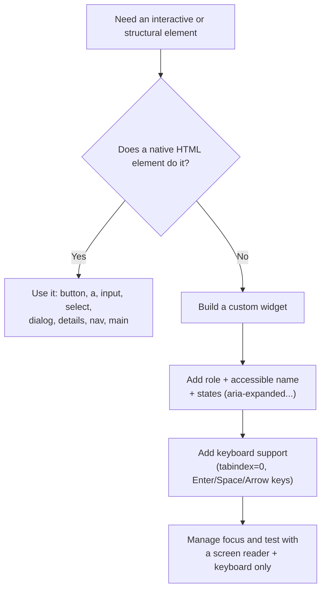

import { Tabs, TabItem, Aside } from '@astrojs/starlight/components';
import QuizBlock from '~/components/QuizBlock.astro';

## Why it matters in interviews

HTML rarely gets its own round, but it shows up as *"why not just use a `div` with a click handler?"*, *"how do you make this form accessible?"* or *"what does ARIA do?"*. Product companies and anyone selling into the EU or US public sector care: the European Accessibility Act has applied since June 2025, and WCAG 2.2 AA is the usual target. A confident answer shows you build UIs that work for keyboard and screen-reader users, not just mouse users.

## Core idea

The browser turns your HTML into the DOM **and** an **accessibility tree**: each node gets a **role** (button, link, heading), a **name** (the text a screen reader announces) and **states** (expanded, checked, disabled). Assistive technology reads this tree, not your CSS. Semantic HTML fills it in for free; a `div` with a click handler gives it nothing.



### Semantic elements and landmarks

| Element | Meaning | Landmark role |
|---|---|---|
| `header` (top-level) | site/page header | banner |
| `nav` | a block of navigation links | navigation |
| `main` | the primary content (one per page) | main |
| `aside` | related, secondary content | complementary |
| `footer` (top-level) | site/page footer | contentinfo |
| `section` | thematic group, should have a heading | region (only when it has an accessible name) |
| `article` | self-contained item (post, card, comment) | none (article role, not a landmark) |
| `h1`-`h6` | document outline | headings (screen-reader users jump by heading) |

Screen-reader users navigate by landmarks and headings the way sighted users scan a page, so use one `h1`, don't skip levels for styling, and wrap the main content in `main`.

**`button` vs `a`:** a link **navigates** (it has an `href`; in Angular, `routerLink`); a button **does something** (submit, open, toggle). A native `button` is focusable, activates with Enter and Space, has the button role, and submits forms by default, so add `type="button"` for non-submit buttons.

```html
<!-- Bad: no role, no focus, no keyboard, nothing announced -->
<div class="btn" (click)="save()">Save</div>

<!-- Good: all of the above for free -->
<button type="button" (click)="save()">Save</button>
```

### Forms and labels

Every input needs a programmatic label. A `placeholder` is not a label: it disappears when typing, often has low contrast, and isn't reliably announced.

```html
<form (ngSubmit)="submit()">
  <label for="email">Work email</label>
  <input id="email" type="email" name="email" autocomplete="email" required
         [attr.aria-invalid]="emailInvalid()" aria-describedby="email-error" />
  @if (emailInvalid()) {
    <p id="email-error" class="error">Enter a valid email address</p>
  }

  <fieldset>
    <legend>Delivery speed</legend>
    <label><input type="radio" name="speed" value="std" /> Standard</label>
    <label><input type="radio" name="speed" value="exp" /> Express</label>
  </fieldset>

  <button type="submit">Place order</button>
</form>
```

Key points: `label for` matches the input `id` (or wrap the input in the label); `fieldset` + `legend` name a group of radios or checkboxes; correct `type` (`email`, `tel`, `number`) gives the right mobile keyboard and validation; `autocomplete` helps password managers and users with motor or memory impairments; link error text with `aria-describedby` and mark the field `aria-invalid`.

### ARIA basics

ARIA (Accessible Rich Internet Applications) attributes **change only the accessibility tree**. They add no behaviour, focus or keyboard handling.

| Kind | Examples | Use |
|---|---|---|
| Roles | `role="dialog"`, `role="tablist"`, `role="alert"` | say what a custom widget is |
| Naming | `aria-label`, `aria-labelledby`, `aria-describedby` | give an icon button a name, link help text |
| States | `aria-expanded`, `aria-selected`, `aria-checked`, `aria-current="page"` | reflect UI state, update it on change |
| Visibility | `aria-hidden="true"` | hide decorative content from AT (never on focusable elements) |
| Live regions | `aria-live="polite"`, `role="status"`, `role="alert"` | announce dynamic updates (toasts, "3 results") |

**The first rule of ARIA:** if a native element with the semantics and behaviour you need exists, use it instead of adding ARIA. Bad ARIA is worse than none: `role="button"` on a `div` promises keyboard support that you then have to build yourself.

### Keyboard navigation and focus

- Everything clickable must be reachable with **Tab** and operable with **Enter/Space** (and arrow keys inside composite widgets like tabs or menus).
- **Tab order follows DOM order.** Fix the order in markup, not with positive `tabindex`.
- `tabindex="0"` adds a custom element to the tab order; `tabindex="-1"` makes it focusable from script only (e.g. a heading you focus after navigation); positive values create a confusing global order, avoid them.
- Never remove the focus outline without a replacement; use `:focus-visible` to show it for keyboard users only.
- **Manage focus in SPAs:** after a route change, move focus to the new `h1` or main region; when a dialog opens, move focus into it, keep it there, and restore it on close. The native `dialog` element opened with `showModal()` makes the rest of the page inert and closes on Escape. Angular CDK provides `cdkTrapFocus`, `LiveAnnouncer` and `FocusMonitor`.
- Add a **skip link** ("Skip to main content") as the first focusable element.

### Alt text

| Image type | Alt text |
|---|---|
| Informative (chart, product photo) | describe the information or purpose: "Sales up 20% in Q3" |
| Decorative (background flourish) | `alt=""` so screen readers skip it (don't omit the attribute) |
| Functional (icon inside a link/button) | describe the action or destination: "Search", "Home" |
| Complex (diagram) | short alt + longer description nearby |

Without an `alt` attribute, many screen readers announce the file name ("IMG underscore 2041 dot png").

### SEO basics and meta tags

Search engines reward the same things screen readers need: semantic structure, one clear `h1`, descriptive link text (not "click here"), alt text and fast pages.

```html
<head>
  <meta charset="utf-8" />
  <meta name="viewport" content="width=device-width, initial-scale=1" />
  <title>Order history | Contoso</title>
  <meta name="description" content="View and track your past Contoso orders." />
  <link rel="canonical" href="https://contoso.com/orders" />
  <meta property="og:title" content="Order history" />
  <meta name="robots" content="noindex" /> <!-- e.g. for private pages -->
</head>
```

A client-rendered SPA ships an almost empty `index.html`; crawlers that don't run JavaScript, and social-media link previews, see nothing useful. Angular SSR or prerendering fixes that. Set per-route titles with the route `title` property (or the `Title` service) and descriptions with the `Meta` service. `html lang="en"` matters for both pronunciation by screen readers and search.

## Code

```ts
// Angular: accessible disclosure (expand/collapse) built on a native button.
@Component({
  selector: 'app-faq-item',
  template: `
    <h3>
      <button type="button" [attr.aria-expanded]="open()" [attr.aria-controls]="panelId"
              (click)="open.set(!open())">
        {{ question() }}
      </button>
    </h3>
    <div [id]="panelId" [hidden]="!open()">
      <ng-content />
    </div>
  `,
})
export class FaqItem {
  question = input.required<string>();
  open = signal(false);
  panelId = `faq-panel-${crypto.randomUUID()}`;
}

// Announce async results to screen readers.
export class SearchPage {
  private announcer = inject(LiveAnnouncer); // @angular/cdk/a11y
  onResults(count: number) { this.announcer.announce(`${count} results found`, 'polite'); }
}
```

## Interview Q&A

<details>
<summary>Why use semantic HTML instead of `div`s?</summary>

Semantic elements carry meaning into the accessibility tree (roles, names, landmarks), give built-in keyboard behaviour (buttons, links, form controls), help search engines understand the page, and make code easier to read. A `div` needs ARIA plus hand-written keyboard and focus handling to match a `button`, and teams usually get it wrong.
</details>

<details>
<summary>What is ARIA and when should you use it?</summary>

A set of attributes that set roles, names and states in the accessibility tree. Use it only when native HTML can't express the widget (tabs, comboboxes, tree views) or to add state (`aria-expanded`) and names (`aria-label` on an icon button). It adds no behaviour, so a custom widget still needs keyboard support and focus management.
</details>

<details>
<summary>How do you make a form accessible?</summary>

Visible `label` elements linked to inputs, `fieldset`/`legend` for groups, correct input types and `autocomplete`, required fields marked in text not only colour, errors linked with `aria-describedby` and `aria-invalid`, focus moved to the first error (or an error summary) on submit, and a real submit `button`.
</details>

<details>
<summary>What does `tabindex` do, and why avoid positive values?</summary>

`0` puts an element in the natural tab order, `-1` makes it focusable by script only, and positive values put elements ahead of everything else in numeric order. Positive values break the expected top-to-bottom flow and become unmaintainable; reorder the DOM instead.
</details>

<details>
<summary>How do you handle focus in a single-page app?</summary>

On route change move focus to the new page heading (or main) so screen readers announce the new content; trap focus inside open modals and return it to the trigger on close; announce async results with a live region. Angular CDK's `FocusTrap` and `LiveAnnouncer` help.
</details>

<details>
<summary>When should an image have empty alt text?</summary>

When it's purely decorative and conveys nothing the surrounding text doesn't. `alt=""` tells assistive technology to skip it. Omitting `alt` entirely is different: the image is announced, often by file name.
</details>

<details>
<summary>What are the SEO challenges of an Angular SPA?</summary>

The initial HTML has no content, titles and meta tags are set by JavaScript, and some crawlers and link-preview bots don't execute JavaScript. Use SSR or prerendering, set per-route `title` and meta description, use real `a href` links (via `routerLink`), semantic headings, and keep Core Web Vitals healthy.
</details>

## Pitfalls

<Aside type="caution" title="Common mistakes">

- **Clickable `div`/`span`** instead of `button` or `a`.
- **Placeholder as label**, or labels not linked to inputs.
- **`outline: none`** on focus without a visible replacement.
- **`aria-hidden="true"` on focusable elements**, creating invisible tab stops.
- **Using colour alone** to show errors or status (red border only). Add text or an icon with a name.
- **Heading levels chosen for size** (skipping from `h1` to `h4`). Style with CSS instead.
- **Redundant ARIA** like `role="button"` on a `button`, or `aria-label` that contradicts the visible text.
- **Modals without focus management**: focus stays behind the overlay.

</Aside>

## Related

- [CSS layout & styling](../css-layout/)
- [Browser, DOM & storage](../browser-dom/)
- [Angular forms](../../angular/forms/)
- [SSR & hydration](../../angular/ssr-hydration/)

## Quick quiz

<QuizBlock section="web" topic="html-accessibility" />
