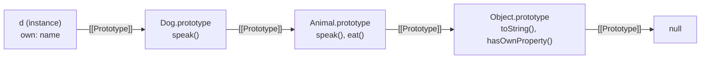

import { Tabs, TabItem, Aside } from '@astrojs/starlight/components';
import QuizBlock from '~/components/QuizBlock.astro';

## Why it matters in interviews

These four topics are the "do you actually know JavaScript, or just Angular?" check. Typical prompts: *"what is a closure, give a real use"*, *"why does this loop print 3, 3, 3?"*, *"what is `this` here?"*, *"how does inheritance work without classes?"*. A C# developer's instincts (block scope, `this` always the instance, class-based inheritance) are wrong in exactly the places interviewers like to poke.

## Core idea

### Scope: var, let, const

| | `var` | `let` | `const` |
|---|---|---|---|
| Scope | function | block | block |
| Hoisted | yes, initialised to `undefined` | yes, but uninitialised (TDZ) | yes, but uninitialised (TDZ) |
| Re-declare in same scope | allowed | error | error |
| Re-assign | yes | yes | no (but the object it points to is still mutable) |
| Creates a property on `window` at top level | yes (in classic scripts) | no | no |

**Hoisting** means declarations are registered when the scope is created, before any line runs. Function declarations are hoisted **with their body**; `var` is hoisted as `undefined`; `let`, `const` and `class` are hoisted but sit in the **temporal dead zone (TDZ)** until their line executes, and touching them throws `ReferenceError`.

```js
console.log(typeof a, typeof b, typeof c); // undefined function undefined
var a = 1;
function b() {}
var c = function () {};  // only the var is hoisted, not the function

let x = 1;
{
  console.log(x);  // ReferenceError: the inner x is in its TDZ (it shadows the outer one)
  let x = 2;
}
```

### Closures

A closure is a function **plus the variables of the scope it was created in**. The inner function keeps a live reference to those variables (not a copy), even after the outer function has returned.

```js
function makeCounter() {
  let count = 0;                      // private state
  return { inc: () => ++count, get: () => count };
}
const c1 = makeCounter();
const c2 = makeCounter();
c1.inc(); c1.inc(); c2.inc();
console.log(c1.get(), c2.get());      // 2 1, each call creates a new scope
```

Real uses: private state (module pattern), factories, memoisation caches, event handlers that remember an id, and `debounce` (the timer id lives in a closure). In Angular, every arrow function you pass to `subscribe`, `computed` or `effect` is a closure over the component's fields.

**The loop pitfall**

```js
for (var i = 0; i < 3; i++) setTimeout(() => console.log(i), 0); // 3 3 3
for (let j = 0; j < 3; j++) setTimeout(() => console.log(j), 0); // 0 1 2
```

`var` creates one `i` for the whole function, and all three callbacks close over it; by the time they run the loop has finished with `i === 3`. `let` creates a **fresh binding per iteration**. C# had the same bug with `foreach` before C# 5 (see [Delegates & lambdas](../../csharp/delegates-events/)).

**Memory:** a closure keeps its whole captured scope alive. A long-lived listener or subscription that closes over a big object leaks it until the listener is removed.

### The rules for `this`

`this` is decided by **how a function is called**, not where it is defined (except for arrow functions). Check the rules in priority order:

| Call style | `this` is | Example |
|---|---|---|
| `new Fn()` | the new object | `new User('Asha')` |
| `fn.call(obj)` / `apply` / `bind` | `obj` | `greet.call(admin)` |
| Method call `obj.fn()` | `obj` (the thing before the dot) | `user.greet()` |
| Plain call `fn()` | `undefined` in strict mode / modules, global object in sloppy scripts | `const g = user.greet; g()` |
| Arrow function | `this` of the **enclosing scope**, fixed forever | `setTimeout(() => this.save())` |

```js
const user = {
  name: 'Asha',
  regular() { return this?.name; },
  arrow: () => this?.name,            // `this` of the module scope, not user
  delayed() { setTimeout(() => console.log(this.name), 0); }, // arrow keeps user
};
user.regular();                       // 'Asha'
user.arrow();                         // undefined (in an ES module)
const r = user.regular; r();          // undefined: plain call, method "lost" its object
user.regular.call({ name: 'Ravi' });  // 'Ravi'
user.regular.bind({ name: 'B1' }).call({ name: 'B2' }); // 'B1': bind cannot be overridden by call
user.delayed();                       // logs 'Asha' later
```

The "lost `this`" bug appears whenever you pass a method as a callback: `button.addEventListener('click', this.save)` or `items.map(this.format)`. Fix it with an arrow wrapper, `bind`, or a class field arrow function (`save = () => {...}`).

**call vs apply vs bind:** `call(thisArg, a, b)` and `apply(thisArg, [a, b])` invoke immediately; `bind(thisArg, ...preset)` returns a new function with `this` (and optionally leading arguments) fixed permanently.

**Arrow functions** have no own `this`, `arguments`, `super` or `prototype`, and can't be used with `new`. That makes them ideal for callbacks inside methods and wrong for object methods that need `this`.

### Prototypes

Every object has a hidden link, `[[Prototype]]` (read with `Object.getPrototypeOf(obj)`, historically `__proto__`). When you read a property, JavaScript looks at the object itself, then walks up the chain until it finds the key or reaches `null`. Writing a property always creates it on the object itself (shadowing).



Methods live **once** on the prototype and are shared by all instances. Changing the prototype later affects existing instances immediately, because lookup is live.

### Classes are (mostly) sugar

```js
class Animal { speak() { return 'generic'; } }
class Dog extends Animal { speak() { return 'woof'; } }
const d = new Dog();

Object.getPrototypeOf(d) === Dog.prototype;                 // true
Object.getPrototypeOf(Dog.prototype) === Animal.prototype;  // true
typeof Dog;                                                 // 'function'
d.hasOwnProperty('speak');                                  // false: it is on the prototype
```

`class` builds the same constructor-function-plus-prototype structure as ES5 code, with some real differences: class bodies are always strict, classes must be called with `new`, are in the TDZ until declared, methods are non-enumerable, and they support `#private` fields (truly private at runtime, unlike TypeScript's `private`, which is compile-time only) and `static` blocks.

## Code

<Tabs syncKey="lang">
  <TabItem label="TypeScript">
```ts
// Closure-based memoisation with a private cache.
function memoize<A extends string | number, R>(fn: (arg: A) => R) {
  const cache = new Map<A, R>();
  return (arg: A): R => {
    if (!cache.has(arg)) cache.set(arg, fn(arg));
    return cache.get(arg)!;
  };
}
const slowSquare = (n: number) => { for (let i = 0; i < 1e7; i++); return n * n; };
const fastSquare = memoize(slowSquare);

// `this` safety in a class used as a callback.
class Uploader {
  #queue: File[] = [];                   // runtime-private field
  add = (file: File) => this.#queue.push(file); // arrow field: `this` always bound
  count() { return this.#queue.length; }
}
const up = new Uploader();
const input = document.querySelector<HTMLInputElement>('input[type=file]')!;
input.addEventListener('change', () => [...input.files!].forEach(up.add)); // safe
```
  </TabItem>
  <TabItem label="C#">
```csharp
// C# closures capture variables the same way (by reference to the variable).
Func<int> MakeCounter()
{
    var count = 0;
    return () => ++count;
}
var c1 = MakeCounter();
c1(); c1();   // 2, the lambda keeps `count` alive on a heap-allocated closure class
// C# `this` is always the instance; there is no "lost this" problem.
```
  </TabItem>
</Tabs>

## Interview Q&A

<details>
<summary>What is a closure? Give a practical example.</summary>

A function together with the variables from the scope where it was defined; it can read and update them after that scope has returned. Practical examples: a counter or cache with private state, `debounce` keeping its timer id, a click handler in a loop that remembers its row id, or Angular `computed(() => this.items().length)`.
</details>

<details>
<summary>Why does a `var` loop with `setTimeout` print the same value three times?</summary>

`var` is function-scoped, so there is a single `i`. All callbacks close over that one variable and run after the loop ends, when `i` is 3. `let` creates a new binding per iteration, so each callback sees its own value. Old fixes were an IIFE or passing `i` as a parameter.
</details>

<details>
<summary>What is the temporal dead zone?</summary>

The period between entering a scope and executing a `let`/`const`/`class` declaration. The binding exists (it is hoisted and shadows outer variables) but is uninitialised, so any access throws `ReferenceError`. It turns "used before declared" bugs, which `var` silently allowed as `undefined`, into errors.
</details>

<details>
<summary>How is `this` determined?</summary>

By the call site: `new` gives the new object; `call`/`apply`/`bind` give the passed object; `obj.method()` gives `obj`; a plain call gives `undefined` in strict mode (global object in sloppy mode). Arrow functions ignore all of this and use `this` from their enclosing scope. `bind` creates a permanently bound function that later `call` cannot change (only `new` can override it).
</details>

<details>
<summary>When should you not use an arrow function?</summary>

As an object or prototype method that needs `this` to be the object, as a constructor (arrows can't be `new`ed), when you need `arguments`, and for DOM handlers where you rely on `this` being the element. Use them for callbacks inside methods so they inherit the method's `this`.
</details>

<details>
<summary>Explain the prototype chain.</summary>

Each object links to a prototype object. Property reads walk the chain (own properties, then the prototype, then its prototype, up to `Object.prototype` and finally `null`). Methods defined on a prototype are shared by all instances. Inheritance is just linking one prototype to another, which is what `extends` sets up.
</details>

<details>
<summary>Are JavaScript classes the same as C# classes?</summary>

No. They are syntax over prototypes: methods live on a shared prototype object, objects can be modified at runtime, and there is no compile-time type checking or overloading. TypeScript adds types, but `private` and `readonly` are erased; only `#private` fields are enforced at runtime.
</details>

<details>
<summary>What is the difference between `call`, `apply` and `bind`?</summary>

All three set `this`. `call(obj, a, b)` invokes now with individual arguments, `apply(obj, [a, b])` invokes now with an array, `bind(obj, a)` returns a new function with `this` (and optionally leading arguments) fixed, to be called later. With spread syntax, `apply` is rarely needed today.
</details>

## Pitfalls

<Aside type="caution" title="Common mistakes">

- **Passing a method as a callback** (`.subscribe(this.handle)`, `addEventListener('click', this.save)`) loses `this`. Wrap in an arrow or bind.
- **Arrow functions as object methods** expecting `this` to be the object.
- **`var` in loops with async callbacks.** Use `let`.
- **Accidental globals**: assigning to an undeclared variable in sloppy mode creates a global (modules and classes are strict, so it throws).
- **Closures that leak**: event listeners, intervals or subscriptions that are never removed keep their captured scope alive.
- **Mutating built-in prototypes** (`Array.prototype.myFn = ...`) affects every array in the app and can clash with future standards.
- **Assuming `const` means immutable.** It only stops reassignment.

</Aside>

## Related

- [Event loop, promises & async](../js-event-loop/)
- [Practical JavaScript](../js-practical/)
- [Delegates, events & lambdas in C#](../../csharp/delegates-events/)
- [OOP concepts](../../fundamentals/oop-concepts/)

## Quick quiz

<QuizBlock section="web" topic="js-core" />
