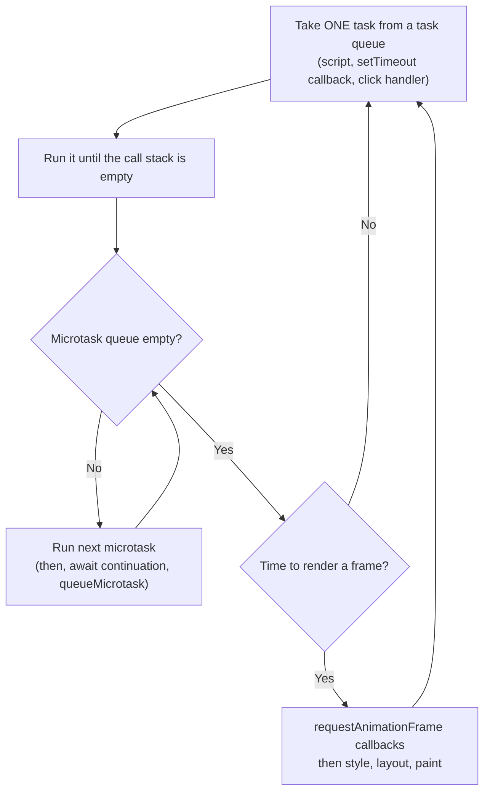
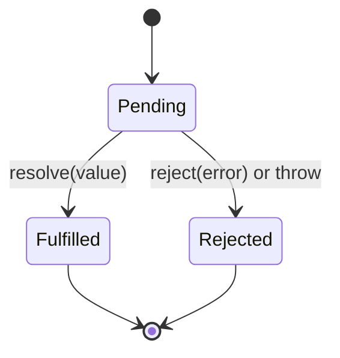

import { Tabs, TabItem, Aside } from '@astrojs/starlight/components';
import QuizBlock from '~/components/QuizBlock.astro';

## Why it matters in interviews

*"What does this print?"* with a mix of `setTimeout`, `Promise.then` and `async` functions is the most common JavaScript question in Angular interviews. It checks whether you know that JavaScript runs on **one thread**, how **microtasks** and **macrotasks** are ordered, and why Angular's change detection (zone.js) hooks into exactly this machinery. Expect a follow-up on `Promise.all` vs `allSettled` and on error handling with `await`.

## Core idea

A browser tab runs your JavaScript on a **single main thread** with one **call stack**. Long-running work (timers, network, DOM events) is handled by the browser outside that thread, and when it finishes a **callback is queued**. The **event loop** decides what runs next.

### The queues

| Queue | Filled by | When it runs |
|---|---|---|
| **Call stack** | the currently running synchronous code | now, to completion (never interrupted) |
| **Microtask queue** | `Promise.then/catch/finally`, code after `await`, `queueMicrotask`, `MutationObserver` | after the current task, **until the queue is empty**, including microtasks added meanwhile |
| **Task (macrotask) queues** | `setTimeout`, `setInterval`, DOM events, `MessageChannel`, network callbacks | one task per loop iteration |
| **Rendering** | style, layout, paint; `requestAnimationFrame` callbacks run just before it | between tasks, when the browser decides a frame is due (about every 16 ms at 60 Hz) |

### One loop iteration



Three rules solve almost every puzzle:

1. **Synchronous code runs first**, top to bottom. The executor of `new Promise(fn)` is synchronous, and so is an `async` function **up to its first `await`**.
2. **All microtasks drain before the next task.** A `then` always beats a `setTimeout(..., 0)` scheduled at the same time.
3. **`setTimeout(fn, 0)` is "at least 0 ms"**, then it waits its turn in the task queue (browsers clamp deeply nested timers to at least 4 ms).

<Aside type="note" title="Microtasks can starve rendering">
Because the microtask queue must be empty before the browser can render, a promise chain that keeps scheduling more microtasks freezes the page just like a `while (true)` loop. Long CPU work should be chunked with `setTimeout`/`scheduler.yield()` or moved to a Web Worker.
</Aside>

### Output-order puzzles (all verified)

**Puzzle 1: the classic**

```js
console.log('A');
setTimeout(() => console.log('B'), 0);
Promise.resolve().then(() => console.log('C'));
console.log('D');
// A, D, C, B
```

Sync logs first (A, D), then the microtask (C), then the next task (B).

**Puzzle 2: async functions run synchronously until await**

```js
async function load() {
  console.log('1');
  await null;          // even awaiting a non-promise yields
  console.log('2');
}
console.log('3');
load();
console.log('4');
// 3, 1, 4, 2
```

**Puzzle 3: everything together**

```js
async function a1() {
  console.log('a1 start');
  await a2();
  console.log('a1 end');
}
async function a2() { console.log('a2'); }

console.log('script start');
setTimeout(() => console.log('timeout'), 0);
a1();
new Promise((r) => { console.log('p executor'); r(); })
  .then(() => console.log('then 1'))
  .then(() => console.log('then 2'));
console.log('script end');
// script start, a1 start, a2, p executor, script end,
// a1 end, then 1, then 2, timeout
```

`a1 end` is queued first (its await was reached first), `then 2` is only queued when `then 1` finishes, and the timeout waits for the whole microtask queue.

**Puzzle 4: microtasks scheduled inside microtasks**

```js
setTimeout(() => console.log('t1'), 0);
Promise.resolve().then(() => {
  console.log('p1');
  setTimeout(() => console.log('t2'), 0);
  Promise.resolve().then(() => console.log('p2'));
});
queueMicrotask(() => console.log('m1'));
console.log('s');
// s, p1, m1, p2, t1, t2
```

`p2` is added while the queue is draining, so it still runs before any timer. `t2` was queued after `t1`.

### Promises

A promise is a placeholder for a future value. It is **pending**, then **settles** once to **fulfilled** or **rejected**, and never changes again. `then` returns a **new** promise, which is what makes chaining work: returning a value fulfils the next promise, throwing rejects it, and returning a promise adopts its state.



Unlike an RxJS Observable, a promise is **eager** (the executor runs immediately), **single-value** and **not cancellable** (use `AbortController` to cancel the underlying `fetch`).

### Combinators

| Combinator | Settles when | Result | Rejects when |
|---|---|---|---|
| `Promise.all` | all fulfil, or the first rejects | array of values in **input order** | first rejection (fail-fast) |
| `Promise.allSettled` | all settle | array of `{ status, value / reason }` | never |
| `Promise.race` | the first one settles | that value or error | if the first to settle rejects |
| `Promise.any` | the first one fulfils | that value | all reject, with an `AggregateError` |

Fail-fast in `Promise.all` does **not** cancel the other operations; they keep running and their results are ignored. Newer helpers worth knowing: `Promise.withResolvers()` (ES2024) returns `{ promise, resolve, reject }`, handy for wrapping callback APIs.

C# mapping: `Promise.all` is like `Task.WhenAll`, `Promise.race`/`any` resemble `Task.WhenAny` (which returns the first completed task whether it succeeded or failed).

## Code

<Tabs syncKey="lang">
  <TabItem label="TypeScript">
```ts
// Dashboard: load independent widgets in parallel, tolerate partial failure.
async function loadDashboard(signal: AbortSignal) {
  const [orders, stats, alerts] = await Promise.allSettled([
    fetchJson<Order[]>('/api/orders', signal),
    fetchJson<Stats>('/api/stats', signal),
    fetchJson<Alert[]>('/api/alerts', signal),
  ]);
  return {
    orders: orders.status === 'fulfilled' ? orders.value : [],
    stats: stats.status === 'fulfilled' ? stats.value : null,
    alertsFailed: alerts.status === 'rejected',
  };
}

// Timeout around any promise
function withTimeout<T>(p: Promise<T>, ms: number): Promise<T> {
  let id: ReturnType<typeof setTimeout>;
  const timeout = new Promise<never>((_, reject) => {
    id = setTimeout(() => reject(new Error(`Timed out after ${ms} ms`)), ms);
  });
  return Promise.race([p, timeout]).finally(() => clearTimeout(id));
}
```
  </TabItem>
  <TabItem label="C#">
```csharp
// The same ideas with tasks.
var ordersTask = api.GetOrdersAsync(ct);
var statsTask = api.GetStatsAsync(ct);
await Task.WhenAll(ordersTask, statsTask); // like Promise.all

using var cts = CancellationTokenSource.CreateLinkedTokenSource(ct);
cts.CancelAfter(TimeSpan.FromSeconds(5));  // timeout via cancellation
var first = await Task.WhenAny(ordersTask, Task.Delay(5000, cts.Token));
```
  </TabItem>
</Tabs>

### async/await error handling

```ts
async function save(order: Order) {
  try {
    const res = await fetch('/api/orders', { method: 'POST', body: JSON.stringify(order) });
    if (!res.ok) throw new Error(`HTTP ${res.status}`); // fetch does NOT reject on 4xx/5xx
    return await res.json();  // `return await` inside try so a rejection is caught here
  } catch (e: unknown) {
    console.error('Save failed', e);
    throw e;                  // rethrow so the caller knows
  } finally {
    hideSpinner();
  }
}
```

- `await` turns a rejection into a thrown exception, so `try/catch` works as in C#.
- `return promise` inside `try` **without** `await` lets the rejection escape the `catch`; `return await promise` catches it.
- A rejected promise nobody handles fires `unhandledrejection` in the browser (and crashes Node by default since Node 15).
- `forEach` does not await an async callback. Use `for...of` with `await` (sequential) or `Promise.all(items.map(...))` (parallel).

### Where Angular fits

With **zone.js**, Angular patches async APIs (`setTimeout`, promises, DOM events, XHR) and runs change detection when the zone becomes stable, roughly when the microtask queue is empty after a task. That is why a value set inside a `setTimeout` still updates the view. **Zoneless** Angular (stable since v20.2, the default for new apps in recent versions) drops the patching; change detection is scheduled by signals, `markForCheck()`, template events and the `async` pipe instead. Code that mutated plain fields inside `setTimeout` and relied on zone.js stops updating the view. See [Change detection](../../angular/change-detection/).

## Interview Q&A

<details>
<summary>What is the difference between a microtask and a macrotask?</summary>

Macrotasks (tasks) are callbacks from timers, events and I/O; the loop runs **one** per iteration. Microtasks come from promise reactions, `await` continuations, `queueMicrotask` and `MutationObserver`; after each task the loop runs **all** of them, including newly added ones, before rendering or picking the next task. So a resolved promise's `then` always runs before a `setTimeout(0)` queued at the same time.
</details>

<details>
<summary>Is JavaScript single-threaded? How can it do async work then?</summary>

Your JavaScript runs on one thread, but the runtime is not: the browser (or libuv in Node) performs timers, network and file I/O on other threads or via the OS, then queues callbacks. Web Workers give you extra JavaScript threads with separate memory, communicating by messages.
</details>

<details>
<summary>Does `setTimeout(fn, 0)` run immediately?</summary>

No. It queues a task after at least 0 ms (deeply nested timers are clamped to at least 4 ms). It runs only after the current script and all pending microtasks finish, and possibly after a render. It is a way to defer work to a later task, not to run it now.
</details>

<details>
<summary>`Promise.all` vs `Promise.allSettled` vs `Promise.any`?</summary>

`all` gives all values or fails fast on the first rejection (good when every result is required). `allSettled` waits for everything and reports each outcome (dashboards, bulk operations with partial success). `any` resolves with the first success and rejects with an `AggregateError` only if all fail (redundant mirrors). `race` settles with whichever settles first, success or failure (timeouts).
</details>

<details>
<summary>What happens when an `async` function is called?</summary>

Its body runs synchronously up to the first `await`. Every `await` suspends the function, even when the awaited value is already available, and the rest of the body is resumed later as a microtask. The function immediately returns a pending promise to the caller. A `return` fulfils that promise; a `throw` rejects it.
</details>

<details>
<summary>Why does `fetch` not throw on a 404?</summary>

`fetch` only rejects on network failures (DNS, CORS block, offline, abort). Any HTTP response, including 404 and 500, fulfils the promise; check `res.ok` or `res.status` yourself. Angular's `HttpClient` is different: it errors the observable for non-2xx responses.
</details>

<details>
<summary>How do you run async operations sequentially vs in parallel?</summary>

Sequentially: `for (const id of ids) { await save(id); }`. In parallel: `await Promise.all(ids.map(save))`. With a concurrency limit: process in batches or use a small pool helper (or `mergeMap(fn, 3)` in RxJS). `array.forEach(async ...)` is neither: it fires everything and doesn't wait.
</details>

<details>
<summary>How does the event loop relate to Angular change detection?</summary>

zone.js wraps async APIs so Angular knows when a task and its microtasks finish, and then runs change detection. Many `setTimeout`/`setInterval` calls (e.g. polling) can trigger many cycles; teams use `runOutsideAngular` or move to signals and zoneless, where change detection is scheduled only when signals or explicit notifications say something changed.
</details>

## Pitfalls

<Aside type="caution" title="Common mistakes">

- **Assuming `setTimeout(0)` runs before promise callbacks.** Microtasks always drain first.
- **`array.forEach(async x => await ...)`** does not wait. Use `for...of` or `Promise.all`.
- **Forgetting `return await` inside `try`**: the rejection skips your `catch`.
- **Not checking `res.ok`** with `fetch`.
- **Unhandled rejections**: every promise chain needs a `catch` somewhere, or an `await` inside `try`.
- **Sequential awaits** for independent requests, doubling latency.
- **Assuming `Promise.all` cancels the rest** on failure. Pass an `AbortSignal` if you need cancellation.
- **Heavy synchronous loops** on the main thread freeze the UI; nothing else (not even a click) can run.

</Aside>

## Related

- [Closures, scope, this & prototypes](../js-core/)
- [Practical JavaScript (debounce, throttle)](../js-practical/)
- [Angular change detection](../../angular/change-detection/)
- [C# async/await deep dive](../../csharp/async-await/)

## Quick quiz

<QuizBlock section="web" topic="js-event-loop" />
