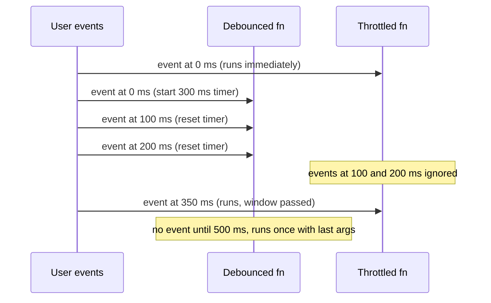

import { Tabs, TabItem, Aside } from '@astrojs/starlight/components';
import QuizBlock from '~/components/QuizBlock.astro';

## Why it matters in interviews

This is the "write it on the whiteboard" part of the JavaScript round: *"implement debounce"*, *"how do you deep-clone an object?"*, *"why is `[] == false` true?"*, *"`||` or `??`?"*. These are everyday bugs in Angular apps too: a search box that hammers the API, a mutated input that OnPush never notices, a quantity of `0` replaced by a default.

## Core idea

### Debounce vs throttle

Both limit how often a function runs when an event fires rapidly (typing, scrolling, resizing).

| | Debounce | Throttle |
|---|---|---|
| Rule | run once the events **stop** for N ms | run **at most once every** N ms |
| Typing "angular" fast with 300 ms | 1 call, after the last key | a call roughly every 300 ms while typing |
| Use for | search-as-you-type, auto-save, validation on input | scroll position, resize, drag, rate-limited button |
| RxJS equivalent | `debounceTime(300)` | `throttleTime(300)` |



```js
function debounce(fn, ms) {
  let timer;                                    // lives in the closure
  return function (...args) {
    clearTimeout(timer);
    timer = setTimeout(() => fn.apply(this, args), ms); // keep caller's this
  };
}

function throttle(fn, ms) {
  let last = 0;
  return function (...args) {
    const now = Date.now();
    if (now - last >= ms) { last = now; fn.apply(this, args); }
  };
}

const search = debounce((q) => console.log('search', q), 300);
search('a'); search('an'); search('ang');       // logs once: search ang
```

This throttle is "leading edge" (runs on the first event, drops the rest in the window). Production versions (lodash) also offer a trailing call so the final value isn't lost, plus `cancel()`/`flush()`. In Angular you usually don't hand-roll these: `valueChanges.pipe(debounceTime(300), distinctUntilChanged(), switchMap(...))` is the idiomatic typeahead.

### Shallow vs deep copy

| Technique | Depth | Keeps Date / Map / Set | Functions | Circular refs |
|---|---|---|---|---|
| `{ ...obj }`, `Object.assign`, `[...arr]` | shallow | references shared | copied by reference | fine (shallow) |
| `JSON.parse(JSON.stringify(x))` | deep | Date becomes string, Map/Set become `{}` | dropped (as is `undefined`) | throws |
| `structuredClone(x)` | deep | yes (also RegExp, typed arrays, Blob) | throws `DataCloneError` | supported |

```js
const original = { id: 1, tags: ['a'], meta: { created: new Date(0) } };
const shallow = { ...original };
shallow.id = 2;            // own copy, original.id stays 1
shallow.tags.push('b');    // SHARED array: original.tags is now ['a', 'b']

const deep = structuredClone(original);
deep.tags.push('c');       // original untouched
deep.meta.created instanceof Date; // true
```

`structuredClone` (available in all evergreen browsers and Node 17+) also drops class prototypes (a `Money` instance comes back as a plain object) and can't clone DOM nodes. For state updates you rarely need a full deep clone: copy only the path you change.

### Equality and coercion

`===` compares without conversion (type and value; objects by reference). `==` applies coercion rules: `null` and `undefined` equal each other and nothing else; otherwise operands are converted towards numbers, and objects to primitives.

```js
0 == ''            // true  ('' -> 0)
null == undefined  // true
null == 0          // false (null only == undefined)
null >= 0          // true  (relational operators DO convert null to 0)
[] == false        // true  ([] -> '' -> 0, false -> 0)
NaN === NaN        // false; use Number.isNaN or Object.is
Object.is(0, -0)   // false, while 0 === -0 is true
```

Rule for code reviews: always `===`, with one accepted idiom, `x == null`, to test for both `null` and `undefined`.

**Falsy values:** `false`, `0`, `-0`, `0n`, `''`, `null`, `undefined`, `NaN`. Everything else is truthy, including `'0'`, `'false'`, `[]` and `{}`.

### Optional chaining and nullish coalescing

```js
const qty = 0, label = '';
qty || 10        // 10  (|| replaces any falsy value)
qty ?? 10        // 0   (?? replaces only null/undefined)
label ?? 'none'  // ''
order.customer?.address?.city   // undefined instead of TypeError
order.items?.length ?? 0
callback?.();                    // call only if defined
settings.retries ??= 3;          // assign only if null/undefined
```

Use `??` for defaults whenever `0`, `''` or `false` are valid values. Don't sprinkle `?.` everywhere: if a value must exist, a crash with a clear stack trace beats silently rendering `undefined`.

### Modules: ESM vs CommonJS

| | ES Modules (`import`/`export`) | CommonJS (`require`/`module.exports`) |
|---|---|---|
| Resolution | static, analysed before running | dynamic, `require` can be anywhere |
| Bindings | **live** (importers see updated values) | a copy of `module.exports` at the time of `require` |
| Loading | asynchronous, supports top-level `await` | synchronous |
| Tree-shaking | yes (bundlers can drop unused exports) | hard |
| `this` at top level | `undefined` (strict mode always) | `module.exports` |
| Where | browsers, Angular, modern Node (`"type": "module"`, `.mjs`) | older Node packages, `.cjs` |

Angular builds (esbuild) are ESM-first; CommonJS dependencies trigger a build warning because they defeat tree-shaking. Dynamic `import()` returns a promise and is how lazy routes load: `loadComponent: () => import('./orders.component').then(m => m.OrdersComponent)`.

### Immutability and array methods

Angular's OnPush and signals compare by **reference**. `this.items().push(x)` mutates the same array, so nothing is detected; `this.items.update(list => [...list, x])` creates a new one.

| Need | Mutating (avoid on state) | Non-mutating |
|---|---|---|
| add | `push`, `unshift` | `[...arr, x]`, `[x, ...arr]` |
| remove | `splice` | `filter`, `toSpliced` |
| sort / reverse | `sort`, `reverse` | `toSorted`, `toReversed` (ES2023) |
| replace one item | `arr[i] = x` | `arr.with(i, x)`, `map` |
| update object | `obj.x = 1` | `{ ...obj, x: 1 }` |

Other everyday methods: `map`, `filter`, `reduce`, `find`/`findLast`, `some`/`every`, `flatMap`, `includes`, `at(-1)`, and `Object.groupBy(items, fn)` (ES2024). Remember that `sort()` without a comparator sorts **as strings**: `[10, 1, 2].sort()` is `[1, 10, 2]`. `Object.freeze` is shallow; nested objects stay mutable.

## Code

<Tabs syncKey="lang">
  <TabItem label="TypeScript">
```ts
// Typed debounce that preserves argument types.
function debounce<A extends unknown[]>(fn: (...args: A) => void, ms: number) {
  let timer: ReturnType<typeof setTimeout> | undefined;
  const debounced = (...args: A) => {
    clearTimeout(timer);
    timer = setTimeout(() => fn(...args), ms);
  };
  debounced.cancel = () => clearTimeout(timer);
  return debounced;
}

// Immutable update of nested state (signal store style).
interface Cart { items: { sku: string; qty: number }[]; coupon?: string }
function setQty(cart: Cart, sku: string, qty: number): Cart {
  return {
    ...cart,
    items: cart.items.map((i) => (i.sku === sku ? { ...i, qty } : i)),
  };
}
// cart.update((c) => setQty(c, 'PEN', 0));  // qty 0 is valid: never use || for defaults here
```
  </TabItem>
  <TabItem label="C#">
```csharp
// C# equivalents: records give value equality and non-destructive `with`.
public record Item(string Sku, int Qty);
public record Cart(ImmutableList<Item> Items, string? Coupon);

Cart SetQty(Cart cart, string sku, int qty) =>
    cart with { Items = cart.Items.Select(i => i.Sku == sku ? i with { Qty = qty } : i).ToImmutableList() };

// ?? and ?. work the same way in C#, and C# == on ints never coerces strings.
```
  </TabItem>
</Tabs>

## Interview Q&A

<details>
<summary>Implement debounce. What does the closure hold?</summary>

Return a wrapper that clears the previous timer and starts a new one with the latest arguments; the timer id lives in the closure, shared by every call of that wrapper. Use `fn.apply(this, args)` (with a non-arrow wrapper) if callers rely on `this`. Mention extras: leading-edge option, `cancel()`, and clearing it when a component is destroyed.
</details>

<details>
<summary>Debounce or throttle for a search box? For scroll?</summary>

Search box: debounce, so the API is called once the user pauses, combined with `distinctUntilChanged` and `switchMap` to cancel stale requests. Scroll or resize: throttle (or `requestAnimationFrame`), because you want regular updates while the event continues, not only after it stops.
</details>

<details>
<summary>How do you deep-copy an object, and what are the limits?</summary>

`structuredClone` handles nested objects, arrays, Date, Map, Set and circular references, but throws on functions and drops class prototypes. `JSON.parse(JSON.stringify())` loses Date, undefined, Map/Set and throws on cycles. Spread and `Object.assign` are only shallow. In state management, prefer targeted immutable updates instead of cloning everything.
</details>

<details>
<summary>`==` vs `===`?</summary>

`===` compares type and value with no conversion; `==` coerces operands first (`'1' == 1`, `0 == ''`, `[] == false` are all true). Use `===` everywhere; the only common exception is `x == null` to match both null and undefined. `Object.is` differs from `===` only for `NaN` and `-0`.
</details>

<details>
<summary>When does `||` give the wrong default?</summary>

When a falsy value is legitimate: a quantity of `0`, an empty string, `false` from a checkbox. `qty || 1` turns 0 into 1. `??` only falls back for `null` or `undefined`, so `qty ?? 1` keeps 0.
</details>

<details>
<summary>ESM vs CommonJS: what are the practical differences?</summary>

ESM is static (imports at the top, analysable), asynchronous, supports top-level `await`, exposes live bindings and enables tree-shaking. CommonJS `require` is synchronous and dynamic and exports a snapshot object. Browsers and Angular use ESM; CommonJS dependencies make bundles larger and trigger Angular build warnings.
</details>

<details>
<summary>Why does my OnPush component not update after `items.push(x)`?</summary>

OnPush (and signals) detect changes by reference. `push` mutates the existing array, so the input reference is unchanged. Create a new array (`[...items, x]` or `signal.update(...)`). The same applies to object inputs: replace them, don't mutate them.
</details>

<details>
<summary>What does `[1, 2, 3].map(parseInt)` return?</summary>

`[1, NaN, NaN]`. `map` passes `(value, index, array)`, so the calls are `parseInt('1', 0)` (radix 0 means default, gives 1), `parseInt('2', 1)` (invalid radix, NaN) and `parseInt('3', 2)` (3 is not a binary digit, NaN). Fix: `map(Number)` or `map((s) => parseInt(s, 10))`.
</details>

## Pitfalls

<Aside type="caution" title="Common mistakes">

- **`||` for numeric or boolean defaults** replaces valid `0`, `''` and `false`. Use `??`.
- **Spread is shallow**: nested arrays and objects are still shared.
- **`JSON` round-trip clones** silently turn dates into strings.
- **`sort()` without a comparator** on numbers, and `sort()` mutating state in place. Use `toSorted((a, b) => a - b)`.
- **Debounce created inside a render/handler** so every call gets a new closure and nothing is ever debounced.
- **Forgetting to cancel** pending debounced calls or timers when a component is destroyed.
- **`Object.freeze` assumed deep.**
- **Floating point**: `0.1 + 0.2 !== 0.3`. Use integers (cents) or a decimal library for money.

</Aside>

## Related

- [Closures, scope, this & prototypes](../js-core/)
- [Event loop & promises](../js-event-loop/)
- [RxJS operators (debounceTime, switchMap)](../../angular/rxjs-operators/)
- [Angular state management](../../angular/state-management/)

## Quick quiz

<QuizBlock section="web" topic="js-practical" />
