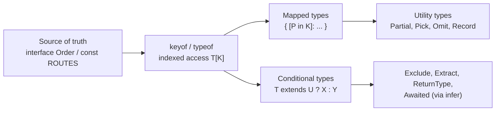

import { Tabs, TabItem, Aside } from '@astrojs/starlight/components';
import QuizBlock from '~/components/QuizBlock.astro';

## Why it matters in interviews

At 3-4 years nobody expects you to write type-level puzzles, but they do expect you to **use utility types fluently** (*"how would you type a PATCH payload?"*), explain **generic constraints**, and, at product companies, **implement `Partial` or `ReturnType` yourself**. Knowing `satisfies` and the strict flags signals that you keep up with the language.

## Core idea

Advanced TypeScript is about **computing types from other types** so a single source of truth (an interface, a const object, a function) drives everything else. Change the source and every derived type follows.



### Generics and constraints

Generics are type parameters, the same idea as C# generics, but checked structurally and erased at runtime (you can't do `new T()` or `typeof T` at runtime).

```ts
// Constraint: T must have an id. K must be a key of T.
function indexBy<T extends { id: string | number }>(items: T[]): Map<T['id'], T> {
  return new Map(items.map((i) => [i.id, i]));
}

function pluck<T, K extends keyof T>(items: T[], key: K): T[K][] {
  return items.map((i) => i[key]);
}

const names = pluck([{ id: 1, name: 'Asha' }], 'name'); // string[]
// pluck(users, 'nmae');  // compile error: not a key

// Default type parameter, like ApiResult<T = unknown>
interface ApiResult<T = unknown> { data: T; total: number }
```

Without the constraint, `x.id` inside the generic function is an error because `T` could be anything. Constraints are how you say "anything, as long as it has this shape".

### keyof, typeof and indexed access

| Operator | Input | Output | Example |
|---|---|---|---|
| `keyof T` | a type | union of its keys | `keyof User` gives `'id' \| 'email'` |
| `typeof x` (type position) | a value | its type | `typeof config` |
| `T[K]` | type + key | property type | `User['email']` is `string` |
| `T[number]` | array/tuple type | element type | `(typeof ROLES)[number]` |

`typeof` and `as const` together let you derive types from runtime constants, so you never declare the same list twice:

```ts
const ROLES = ['admin', 'editor', 'viewer'] as const;
type Role = (typeof ROLES)[number]; // 'admin' | 'editor' | 'viewer'
```

### Utility types you must know

| Utility | What it does | Typical use |
|---|---|---|
| `Partial<T>` | all properties optional | PATCH payloads, form drafts |
| `Required<T>` | all properties required | after defaults are applied |
| `Readonly<T>` | all properties readonly (shallow) | state objects, signal values |
| `Pick<T, K>` | keep only keys K | list-view DTO |
| `Omit<T, K>` | drop keys K | create payload without `id` |
| `Record<K, V>` | object with keys K and values V | lookup maps, `Record<Status, string>` labels |
| `Exclude<U, X>` / `Extract<U, X>` | filter a union | remove `'deleted'` from a status union |
| `NonNullable<T>` | remove `null` and `undefined` | after a null check |
| `ReturnType<F>` / `Parameters<F>` | function result / argument tuple | type a wrapper around a function you don't own |
| `Awaited<T>` | unwrap promises recursively | `Awaited<ReturnType<typeof load>>` |
| `NoInfer<T>` (5.4) | block inference from one argument | default value must match the inferred union |

### Mapped types

A mapped type loops over keys. With modifiers you can add or remove `readonly` and `?`. `Partial`, `Required` and `Readonly` are each one line:

```ts
type MyPartial<T> = { [P in keyof T]?: T[P] };
type MyRequired<T> = { [P in keyof T]-?: T[P] };
type Mutable<T> = { -readonly [P in keyof T]: T[P] };

// Key remapping with `as` + template literal types
type Getters<T> = { [K in keyof T as `get${Capitalize<string & K>}`]: () => T[K] };
type UserGetters = Getters<{ name: string; age: number }>;
// { getName: () => string; getAge: () => number }

// Filtering keys: remap to never to drop them
type OnlyStrings<T> = { [K in keyof T as T[K] extends string ? K : never]: T[K] };
```

### Conditional types and infer

`T extends U ? X : Y` is a type-level if. `infer` declares a type variable inside the `extends` clause and captures whatever matches:

```ts
type MyReturnType<F> = F extends (...args: any[]) => infer R ? R : never;
type ElementOf<T> = T extends readonly (infer E)[] ? E : never;
type UnwrapPromise<T> = T extends Promise<infer V> ? V : T;

type A = ElementOf<string[]>;              // string
type B = UnwrapPromise<Promise<number>>;   // number
```

**Distribution:** when the checked type is a *naked* type parameter and you pass a union, the conditional is applied to each member separately. `Exclude` depends on this.

```ts
type ToArray<T> = T extends unknown ? T[] : never;
type C = ToArray<string | number>;         // string[] | number[]
type ToArrayNoDist<T> = [T] extends [unknown] ? T[] : never;
type D = ToArrayNoDist<string | number>;   // (string | number)[]
```

### Template literal types

Template literal types build string unions: `` `${'GET' | 'POST'} /api/${'users' | 'orders'}` `` is a union of four strings. Combined with `Capitalize`, `Uppercase` and key remapping they type event names (`onClick`), CSS tokens or route keys.

### satisfies

`satisfies` (TS 4.9) checks that a value matches a type **without changing the inferred type**. An annotation widens; `satisfies` validates and keeps the precise type.

```ts
type Route = { path: string; title: string };

const annotated: Record<string, Route> = { home: { path: '/', title: 'Home' } };
// annotated.hmoe -> no error, keys are just string

const routes = {
  home: { path: '/', title: 'Home' },
  orders: { path: '/orders', title: 'Orders' },
} satisfies Record<string, Route>;
routes.orders.path; // OK, and routes.hmoe is a compile error
type RouteKey = keyof typeof routes; // 'home' | 'orders'
```

Related: `const` type parameters (TS 5.0), `function f<const T>(x: T)`, infer literal types as if the caller wrote `as const`.

### Decorators

Decorators are functions applied to classes and members. There are **two models**:

| | Legacy (`experimentalDecorators: true`) | Standard (TS 5.0+, TC39) |
|---|---|---|
| Spec | Old TypeScript-specific proposal | ECMAScript decorators proposal |
| Parameter decorators | Yes | No |
| `emitDecoratorMetadata` | Supported | Not supported |
| Signature | `(target, key, descriptor)` | `(value, context)` |

Angular's `@Component`, `@Injectable` and `@Input` are read by the **Angular compiler** at build time, which generates static definitions; you rarely implement one yourself. The move to `inject()` also removes the need for constructor parameter decorators such as `@Inject()` and `@Optional()`, which standard decorators don't support.

### Strict flags (tsconfig)

`"strict": true` turns on a family of flags. Others are **not** included and are worth enabling deliberately:

| Included in `strict` | Not included (opt in) |
|---|---|
| `noImplicitAny`, `strictNullChecks` | `noUncheckedIndexedAccess` (`arr[i]` is `T \| undefined`) |
| `strictFunctionTypes`, `strictBindCallApply` | `exactOptionalPropertyTypes` |
| `strictPropertyInitialization`, `noImplicitThis` | `noImplicitOverride`, `noFallthroughCasesInSwitch` |
| `alwaysStrict`, `useUnknownInCatchVariables` | `noPropertyAccessFromIndexSignature` |

Angular adds its own template checking: `strictTemplates` in `angularCompilerOptions` type-checks bindings in templates against component inputs.

## Code

<Tabs syncKey="lang">
  <TabItem label="TypeScript">
```ts
interface Product { id: number; name: string; price: number; createdAt: string }

type CreateProduct = Omit<Product, 'id' | 'createdAt'>;
type UpdateProduct = Partial<CreateProduct>;           // PATCH body
type ProductRow = Pick<Product, 'id' | 'name'>;

// A typed API client: one map drives URLs, inputs and outputs.
interface Endpoints {
  'GET /products': { body: void; result: Product[] };
  'POST /products': { body: CreateProduct; result: Product };
}

async function call<K extends keyof Endpoints>(
  key: K, body?: Endpoints[K]['body'],
): Promise<Endpoints[K]['result']> {
  const [method, url] = (key as string).split(' ');
  const res = await fetch(`/api${url}`, { method, body: body ? JSON.stringify(body) : undefined });
  return res.json();
}

const created = await call('POST /products', { name: 'Pen', price: 10 }); // Product
```
  </TabItem>
  <TabItem label="C#">
```csharp
// C# has no mapped types; you write the DTOs by hand (or generate them).
public record Product(int Id, string Name, decimal Price, DateTime CreatedAt);
public record CreateProduct(string Name, decimal Price);
public record UpdateProduct(string? Name, decimal? Price); // "Partial"

// Generic constraints look similar:
public static Dictionary<TKey, T> IndexBy<T, TKey>(IEnumerable<T> items, Func<T, TKey> key)
    where TKey : notnull => items.ToDictionary(key);
```
  </TabItem>
</Tabs>

## Interview Q&A

<details>
<summary>Implement `Partial<T>` and `Readonly<T>` yourself.</summary>

`type MyPartial<T> = { [P in keyof T]?: T[P] }` and `type MyReadonly<T> = { readonly [P in keyof T]: T[P] }`. Both are homomorphic mapped types: they iterate over `keyof T` and copy each property type with a modifier. Mention that both are **shallow**; nested objects are untouched, so a `DeepPartial` needs recursion.
</details>

<details>
<summary>How does `ReturnType` work?</summary>

It is a conditional type with `infer`: `T extends (...args: any) => infer R ? R : any`. If `T` matches a function shape, `R` captures the return type. For async functions it gives `Promise<X>`; wrap it in `Awaited` to get `X`.
</details>

<details>
<summary>What is the difference between `satisfies` and a type annotation?</summary>

An annotation (`const x: T = ...`) makes the variable's type exactly `T`, losing literal keys and narrower property types. `satisfies T` checks compatibility (including excess properties) but keeps the inferred type. Use it for config objects, route tables and lookup maps where you want both validation and autocomplete on the actual keys.
</details>

<details>
<summary>What is a distributive conditional type?</summary>

When a conditional type checks a naked type parameter and receives a union, it is evaluated per member and the results are unioned. That is how `Exclude<'a' | 'b' | 'c', 'a'>` yields `'b' | 'c'`. Wrap both sides in a tuple, `[T] extends [U]`, to turn distribution off.
</details>

<details>
<summary>Why do you need generic constraints?</summary>

Inside a generic function `T` is unknown, so you can't read `x.id`. `T extends { id: number }` restricts callers and lets the body use `id`. `K extends keyof T` ties a key parameter to the object, giving autocomplete and a typed return via `T[K]`.
</details>

<details>
<summary>Which strict flags would you enable on a new project?</summary>

`strict: true` (null checks, no implicit any, strict function types, unknown in catch, and more) plus `noUncheckedIndexedAccess` so index lookups include `undefined`, `noImplicitOverride` for class hierarchies, and Angular's `strictTemplates`. On a legacy codebase, turn them on incrementally per folder or fix errors in batches rather than adding `// @ts-ignore`.
</details>

<details>
<summary>`Record<string, T>` vs an index signature vs `Map`?</summary>

`Record<string, T>` and `{ [key: string]: T }` are the same type for plain objects; `Record` also works with literal unions (`Record<Status, string>` forces every status to have a label). A `Map` is a runtime structure with any key type, insertion order and size, and is better for frequent adds/removes. Plain objects serialize to JSON directly; a `Map` does not.
</details>

<details>
<summary>What changed with decorators in TypeScript 5?</summary>

TS 5.0 implemented the standard ECMAScript decorators proposal, with a new `(value, context)` signature and no parameter decorators or metadata emit. The old behaviour stays available behind `experimentalDecorators`. Frameworks like Angular process their decorators in their own compiler, so day-to-day Angular code is not affected.
</details>

## Pitfalls

<Aside type="caution" title="Common mistakes">

- **`Partial`/`Readonly` are shallow.** Nested objects stay mutable and required.
- **`Omit` is not checked**: `Omit<User, 'emial'>` compiles (keys are `string`), so typos silently keep the property.
- **Annotating config objects** (`const x: Record<string, Route>`) and losing key autocomplete; use `satisfies`.
- **Unexpected distribution** over unions in conditional types; use `[T] extends [U]` when you want the union as a whole.
- **Over-engineering types**: unreadable type gymnastics hurt the team. Prefer simple, named types.
- **Turning on `strict` and silencing everything with `!` or `as`.** Non-null assertions move bugs to runtime.

</Aside>

## Related

- [TypeScript type system](../typescript-types/)
- [Angular signals](../../angular/signals/)
- [Angular forms](../../angular/forms/)
- [Generics in C#](../../csharp/collections-generics/)

## Quick quiz

<QuizBlock section="web" topic="typescript-advanced" />
