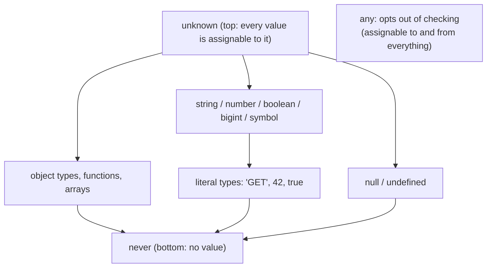

import { Tabs, TabItem, Aside } from '@astrojs/starlight/components';
import QuizBlock from '~/components/QuizBlock.astro';

## Why it matters in interviews

Every Angular round opens with TypeScript. The questions sound simple (*"interface or type?"*, *"any vs unknown?"*, *"enum or union?"*) but the follow-ups test whether you understand that TypeScript is a **compile-time, structural** type system that is **erased** at runtime. Coming from C#, that is the single biggest mental shift, and interviewers probe it with narrowing and discriminated-union questions.

## Core idea

### Structural, not nominal

C# is **nominal**: a `Customer` is only assignable to `ICustomer` if the class declares it. TypeScript is **structural**: a value is assignable to a type if it has **at least the required members** with compatible types. The name doesn't matter.

```ts
interface Point { x: number; y: number }
class Pixel { constructor(public x: number, public y: number, public color = 'red') {} }

const p: Point = new Pixel(1, 2); // OK: Pixel has x and y (extra members are fine)
```

Two consequences you should mention:

1. **Types are erased.** After compilation there is no `Point` at runtime. You cannot `instanceof` an interface, and a `fetch` response typed as `User` is **not validated**. If you need runtime safety, validate with a schema library (Zod, Valibot) at the boundary.
2. **Excess property checks** only apply to **fresh object literals**. `const p: Point = { x: 1, y: 2, z: 3 }` errors, but passing a variable that happens to have `z` does not. This catches typos without breaking structural typing.

### The type hierarchy



- **`unknown`** is the safe top type. You can assign anything to it, but you can't use it until you **narrow** it.
- **`any`** switches the checker off for that value, and it is contagious: `any.foo.bar()` compiles and returns `any`.
- **`never`** is the empty type: a function that always throws, an impossible branch, or `string & number`.
- **`void`** means "the return value should be ignored". It is not the same as `undefined`, which is a real value.

### Unions, intersections and literal types

A **union** `A | B` means "one of these"; you can only use members common to all parts until you narrow. An **intersection** `A & B` means "all of these at once": for object types it combines properties, for incompatible primitives it collapses to `never`.

**Literal types** make a value itself a type: `'GET'`, `404`, `true`. A union of literals is TypeScript's lightweight enum:

```ts
type HttpMethod = 'GET' | 'POST' | 'PUT' | 'DELETE';

let m1 = 'GET';            // type string   (let widens)
const m2 = 'GET';          // type 'GET'    (const keeps the literal)
const cfg = { method: 'GET' };           // cfg.method: string
const cfg2 = { method: 'GET' } as const; // readonly, method: 'GET'
```

Widening is the reason a config object sometimes "isn't assignable" to a function that expects `HttpMethod`. Fix it with `as const`, an explicit annotation, or `satisfies` (see [Advanced TypeScript](../typescript-advanced/)).

### Interface vs type alias

| | `interface` | `type` alias |
|---|---|---|
| Describes object shapes | Yes | Yes |
| Unions, tuples, primitives, mapped/conditional types | No | Yes |
| Extending | `extends` (checked for conflicts) | Intersection `&` (conflicts become `never`) |
| Declaration merging | Yes, two declarations merge | No, duplicate name is an error |
| `implements` in a class | Yes | Yes, if it is an object type |

**Rule of thumb you can say in an interview:** use `interface` for object contracts that others may extend (DTOs, service contracts, library augmentation such as adding a field to `Window`), and `type` for unions, function types, tuples and anything computed. Consistency inside the codebase matters more than the choice.

### Enums vs const objects

```ts
enum Status { Active, Suspended }            // numeric: Status[0] === 'Active' (reverse map)
enum Role { Admin = 'ADMIN', User = 'USER' } // string: no reverse mapping

// Erasable alternative: a plain object + derived union
const OrderState = { Draft: 'DRAFT', Paid: 'PAID', Shipped: 'SHIPPED' } as const;
type OrderState = (typeof OrderState)[keyof typeof OrderState]; // 'DRAFT' | 'PAID' | 'SHIPPED'
```

Enums are one of the few TypeScript features that **emit runtime code** (an object, and for numeric enums a reverse mapping). `const enum` is inlined at compile time but does not work well with `isolatedModules` (single-file transpilers such as esbuild). TypeScript 5.8 added `--erasableSyntaxOnly`, which rejects enums, namespaces and constructor parameter properties so code can run under type-stripping (Node's built-in TypeScript support). Many teams therefore prefer **string-literal unions or `as const` objects**. Enums are still fine, especially string enums for values sent to an API.

## Narrowing

Narrowing is how TypeScript refines a union inside a branch. The checker follows control flow:

| Technique | Example | Narrows to |
|---|---|---|
| `typeof` | `typeof x === 'string'` | primitives |
| `instanceof` | `err instanceof HttpErrorResponse` | class instances |
| `in` | `'kind' in shape` | objects with that key |
| Equality / truthiness | `x !== null`, `if (x)` | removes `null`/`undefined` (and falsy) |
| Discriminant | `shape.kind === 'circle'` | one union member |
| Type predicate | `function isUser(x): x is User` | whatever you assert |
| Assertion function | `function check(x): asserts x is User` | rest of the scope |

Since TypeScript 5.5 the compiler **infers** simple predicates, so `items.filter(x => x !== undefined)` now returns `T[]` instead of `(T | undefined)[]`.

A user-defined type guard is a **promise to the compiler**; if the body is wrong, the types lie. Keep guards small and test them.

### Discriminated unions and exhaustiveness

A **discriminated union** is a union of object types that share a literal "tag" property. It is the TypeScript way to model state machines and API results, and pairs well with Angular's `@switch`.

```ts
type LoadState<T> =
  | { status: 'idle' }
  | { status: 'loading' }
  | { status: 'success'; data: T }
  | { status: 'error'; error: string };

function render(s: LoadState<string[]>): string {
  switch (s.status) {
    case 'idle': return 'Nothing yet';
    case 'loading': return 'Loading...';
    case 'success': return `${s.data.length} items`; // s.data exists only here
    case 'error': return `Failed: ${s.error}`;
    default: {
      const unreachable: never = s; // compile error if a new status is added
      return unreachable;
    }
  }
}
```

The `never` assignment is the **exhaustive check**: add `{ status: 'cancelled' }` and every switch that forgot it stops compiling. This is the TypeScript equivalent of a C# switch expression warning on an unhandled case.

## Code

<Tabs syncKey="lang">
  <TabItem label="TypeScript">
```ts
// Validating an unknown API payload: unknown -> narrowed -> typed.
interface User { id: number; email: string }

function isUser(value: unknown): value is User {
  return (
    typeof value === 'object' && value !== null &&
    'id' in value && typeof value.id === 'number' &&
    'email' in value && typeof value.email === 'string'
  );
}

async function loadUser(id: number): Promise<User> {
  const body: unknown = await fetch(`/api/users/${id}`).then((r) => r.json());
  if (!isUser(body)) throw new Error('Unexpected payload');
  return body; // narrowed to User
}

// catch variables are unknown under strict (useUnknownInCatchVariables)
try { await loadUser(1); }
catch (e) { console.error(e instanceof Error ? e.message : String(e)); }
```
  </TabItem>
  <TabItem label="C#">
```csharp
// Closest C# equivalent: a closed hierarchy + pattern matching.
public abstract record LoadState;
public sealed record Loading : LoadState;
public sealed record Success(string[] Data) : LoadState;
public sealed record Failed(string Error) : LoadState;

static string Render(LoadState s) => s switch
{
    Loading => "Loading...",
    Success ok => $"{ok.Data.Length} items",
    Failed f => $"Failed: {f.Error}",
    _ => throw new UnreachableException()
};
```
  </TabItem>
</Tabs>

In an Angular template, the same union drives control flow:

```html
@switch (state().status) {
  @case ('loading') { <app-spinner /> }
  @case ('error') { <p class="error">Could not load orders</p> }
  @case ('success') { <app-order-list [orders]="orders()" /> }
}
```

## Interview Q&A

<details>
<summary>What is the difference between `any` and `unknown`?</summary>

Both accept any value. `any` also lets you **do** anything with it (call it, read properties) with no checking, and it leaks into everything it touches. `unknown` forces you to narrow first (`typeof`, `instanceof`, a type guard or schema validation). Use `unknown` for values you don't control: JSON, `catch` variables, `postMessage` data.
</details>

<details>
<summary>When would you use `never`?</summary>

For exhaustiveness checks in a `switch` over a discriminated union, as the return type of functions that always throw (`function fail(msg: string): never`), and in conditional types to filter members out (`Exclude` is built on it). If a variable of type `never` is reachable, the compiler is telling you a case is missing.
</details>

<details>
<summary>Interface or type: which do you use and why?</summary>

Both describe object shapes. Interfaces support declaration merging and `extends` with conflict checking, so they suit public contracts and augmenting library types. Type aliases are required for unions, tuples, function types and mapped/conditional types. I default to interfaces for DTOs and types for everything else, but I follow the codebase convention.
</details>

<details>
<summary>Do TypeScript types exist at runtime?</summary>

No, they are erased. That is why you can't `instanceof` an interface and why an HTTP response typed as `Order` may still be wrong. Runtime checks need real JavaScript: classes with `instanceof`, discriminant fields, or schema validation at API boundaries.
</details>

<details>
<summary>Why might you avoid `enum`?</summary>

Enums emit runtime objects, numeric enums have reverse mappings, `const enum` is awkward with isolated-module transpilers, and `--erasableSyntaxOnly` rejects enums. A string-literal union (or an `as const` object plus a derived union) gives the same safety with zero runtime cost. String enums remain a reasonable choice when you want a named set of API values.
</details>

<details>
<summary>What is a discriminated union and why is it useful?</summary>

A union of object types sharing a literal property (`kind`, `status`, `type`). Checking that property narrows to one member, so you only access fields that exist in that state. It makes illegal states unrepresentable (no `data` while `loading`) and, with a `never` default, the compiler flags unhandled cases. NgRx actions and API result types are typical uses.
</details>

<details>
<summary>What does structural typing mean for a C# developer?</summary>

Compatibility is decided by shape, not by declared names. Any object with the right members satisfies an interface without `implements`. Two different interfaces with identical members are interchangeable. The trade-off is that you lose "brand" safety (a `UserId` and an `OrderId` that are both `number` are mixable) unless you use branded types such as `number & { __brand: 'UserId' }`.
</details>

<details>
<summary>What is the difference between a type assertion (`as`) and narrowing?</summary>

`x as User` tells the compiler to trust you: it only checks that the types overlap at all, and nothing is checked at runtime. Narrowing is proven by real runtime checks the compiler can follow. Prefer narrowing; reserve `as` for cases where you genuinely know more than the compiler (DOM queries, test fixtures), and never use `as any` to silence a real error.
</details>

## Pitfalls

<Aside type="caution" title="Common mistakes">

- **Trusting HTTP types.** `http.get<User>()` is a cast, not validation. Validate untrusted data.
- **`any` creeping in** from untyped libraries, `JSON.parse` or `catch (e: any)`. Use `unknown` and keep `noImplicitAny` on.
- **Literal widening**: `let method = 'GET'` is `string`, so it fails where `'GET' | 'POST'` is expected. Use `const` or `as const`.
- **Intersecting incompatible types** (`{ id: string } & { id: number }`) silently produces `never` for `id`.
- **Numeric enums** used in arithmetic or persisted as numbers, so reordering members changes stored data.
- **Over-trusting type guards**: a wrong `x is T` predicate lies to the compiler everywhere it is used.

</Aside>

## Related

- [Advanced TypeScript](../typescript-advanced/)
- [Practical JavaScript](../js-practical/)
- [Angular components & templates](../../angular/components-templates/)
- [Modern C# features](../../csharp/modern-csharp/)

## Quick quiz

<QuizBlock section="web" topic="typescript-types" />
